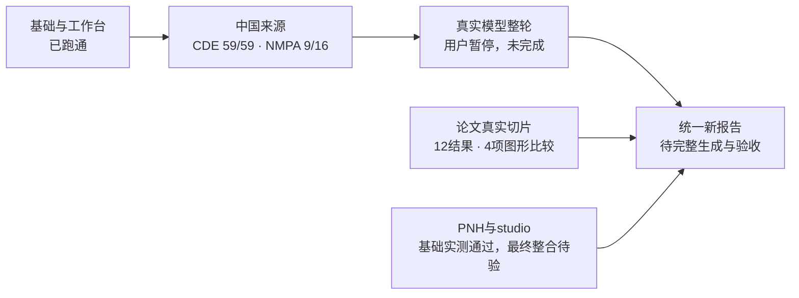

# ciw v2 无损暂停与接续说明

暂停日期：2026-10-27 17:11（Asia/Shanghai）。本轮由用户主动要求暂停，非完成交付。

## 1. 接手先读这四点

1. 唯一当前状态是 [STATUS](../STATUS.md)，产品依据是 [PRD](../PRD.md)、[DECISIONS](../DECISIONS.md)、[PLAN](../PLAN.md)、[ARCHITECTURE](../ARCHITECTURE.md)。原始 [EXECUTION_PACK](EXECUTION_PACK.md) 仍规定 T1–T5，发布分支等旧处以 D13–D16 和当前状态为准。
2. 这次是附件提供的全新 `ciw`，不是旧 `ci_workflow` 或 `rebaseline-v2/ciw2`。不读旧库、不等待旧进程、不重启旧工作流、不恢复会商/签发/资格链。
3. **当前 CRSwNP release 尚未包含新论文切片及本组新事件结果。** 不得把源码测试、论文切片、旧工作台截图和新 PNH 截图拼成一次最终验收。
4. 用户未重新解除暂停前不重新检索、调用模型或构建。恢复后复用本机新工作区原件和响应缓存；另一台机器不能假设这些私有运行数据也在 GitHub。

## 2. 任务的起点与范围

ciw 是医学经理工作台“证据调研与方案设计”的事实底座；首个真实项目是 MG-K10 / CRSwNP。输出一个结构化 release 和 A 竞品全景、B 临床结果、C 设计先例三个 HTML 查看器。工作台读结构化事实，并托管查看器；设计 studio 从 C 的全研究集合读取候选。

较旧工程明确缩小的范围：不做 PDF/PPT/Excel、静态分享、门户事实编辑/撤销、个人配置、定时监测、历史截止回放、药智、三宿主安装包、24 门户矩阵、排名/Meta/NMA。不要重新把这些列为阻断项。

保留的控制点：数值和来源可追溯；缺失不补零；统计类型/人群/时点/单位分开；组角色来自明确关系；原件不改写；异构模型只使用 `ciw.verify.crosscheck`。抽取为 deepseek + qwen，分歧由 glm 仲裁，三者必须不同家族。模型自报信心不参与采用。

### 已裁决，不重问

|决定|含义|
|---|---|
|D13|隔离本地开发身份入口默认关闭，仅回环、只读、限定项目，私钥在库外；不能替代正式宿主认证。|
|D14|DGX使用用户指定接入包中的 workbench 凭据，唯一通过 CIW_DGX_API_KEY / CIW_DGX_KEY_FILE 提供；不读 owner/application key，不改共享服务。|
|D15|CI 推 codex/ciw-v2-trunk，保留旧 main，不强推。远端两个 archive 标签未发现，不宣称已清理旧历史。|
|D16|studio 接当前 release 的 C 行作为候选，保留已有选择/评价流程，由当前 Agent 整合。|
|浏览器|只用 Ego；专用 TaskSpace 可自行重建，不反复询问；用户自行完成滑块，Agent 不代做。|

### 当前 Goal 原文与状态

> 基于v2（ciw）新的、全面的、细节化的任务计划、任务执行规范、资料包（或文件指向链接）、PRD文档、Plan文档，以及分步骤的任务执行包、验收包等等，进行实际的、不间断地任务实现，直至完全交付。 注意对过度设计、构建过程（而非构建完成后）的测试要进行约束，避免出现“改了1处测试1次”的情况

本次实读 Goal API 返回 `paused`。未把未完成目标伪造为完成；本轮暂停继续保持 paused。

## 3. 已推送代码身份

|仓库|分支|本轮产品代码提交|
|---|---|---|
|smkzw/competitive-intelligence-workflow|codex/ciw-v2-trunk|427c006b135c4e2208f01b64a13d27c448cafb17|
|smkzw/protocol-v3-workbench|feat/ciw-release-adapter|1945b82357958086e69393ebbf4d9f988da2ee66|

暂停文档随后单独提交，恢复时从实际 HEAD 开始；上表用于绑定本轮产品代码，不能回退文档提交。两条产品提交均实查远端已推成功。旧 main 当时为 3087943fb81133ede6d221ac2518ebafab19a485，未修改。

源码最初来自附件 SHA256 `c3fa91ecab28b600cc31eea30b900fd5f02d2d62a3887548340a0acf215a783e`，工作台补丁 SHA256 `8011c31e2a0e25754025ee24010836088837d17f7059a9ff98cc65f7aa39448b`。附件、老 Skill、旧审阅都不是新授权来源。

本机新目录用相对 Home 的定位，绝对路径不提交：

|内容|位置|
|---|---|
|CI源码|~/Developer/ciw-v2-20261027|
|工作台源码|~/Developer/ciw-workbench-20261027|
|私有运行父目录|~/Developer/ciw-workspaces-20261027|
|CRSwNP/PNH工作区|该父目录下 crswnp / pnh|
|工作台隔离运行区|该父目录下 workbench-runtime/mw|

默认 cwd 可能仍是旧中文工程，**每条命令显式指定新源码 cwd**；不要触碰旧目录。

## 4. 到底完成到哪里

|里程碑|已证实|尚未完成|
|---|---|---|
|M0 基础|新环境、独立发布、GitHub 干净 clone 的169项测试及Ruff通过|附件中仍有10个超过80物理行的既有函数，见第9节；旧历史清理不在本轮执行|
|M1 CT.gov/门户|真实获取255项CT.gov研究；普通CLI能出A/B/C；旧候选audit40为零错误；既有1440/1920实屏|最新带模型同候选的科学覆盖、数值/来源与工作台实屏尚未完成|
|M2 工作台|只读身份、适配器、托管、宽度调整；T1六张实屏；当前相关单元测试通过|新论文/事件整轮后的工作台消费验证|
|M3 中国来源|CDE59份详情/75登记；NMPA四药9份许可；10篇公司/公众号原文|NMPA另7份详情；本品CRSwNP登记未发现，不能造；原文收件箱已完成不等于模型事件已通过|
|M4 真实模型|三家族确有返回；属性切片；19旧事件逐原文检查发现问题并修规则|新schema整轮、20条模型事件零错误、待核比例<15%尚未通过|
|M5 论文|发现3篇明确关联摘要；CROWNS2真实双模型12结果/4项可绘差值|其余2篇模型抽取、统一release与B实屏；17个检索503仍是缺口|
|M6 泛化/studio|PNH普通CLI新release+audit40+三页实屏；studio160旧候选与选择重开保存已实测|studio须从最终最新C集合重新读取并复验；PNH不是完整竞品覆盖验收|

### 当前发布指针与较早候选

|release|含义|
|---|---|
|CRSwNP rel_ffa0d97f4ca5f9e7|当前指针：330研究、149核心、39景观产品、1690结果、371问题、265比较、9NMPA事件；**那一轮模型DNS失败，论文采用0条**。|
|CRSwNP rel_c2666ccdfa5288a8|早期模型轮：19模型事件+9NMPA；有日期/回顾误判与25属性调用失败；不能作为M4通过证据。|
|CRSwNP rel_87dc2fc802b3fc41|更早候选：160核心，studio原实测读取此版本。科学分类和来源并非最新。|
|CRSwNP rel_f97a596a66e74b01|T1六张工作台A/B/C 1440/1920截图对应版本。|
|PNH rel_ecb40216e04426de|暂停前最新：149研究、68核心、7产品、1410结果、248问题、34比较；audit40/errors=[]；新代码三页1920实屏。|

CRSwNP当前44条队列：10篇文章抽取失败、26个属性抽取失败、1个属性冲突、3篇论文抽取失败、4未归类干预。它描述失败那一轮，不代表现在修好的传输仍不可用。PNH当前62条：56未归类干预、6论文未抽取；不能按队列总数冒充M4模型待核率。

## 5. 本轮关键改动及验证

### 5.1 论文、臂身份与统计对象

- `sources/europepmc.py`：按明确登记号分页获取/保存API原件；摘要中实际出现登记号才绑定；搜索命中本身不是关联证据。综述、方案、事后/亚组分析不自动作为主要结果。离线模式保留失败与待查编号。
- `verify/publications.py`：复用 crosscheck，把原始人群、单位、统计形式、原文与来源放入共同结果；论文/登记并存。无分析N不补样本量；无单组值不造0、不画空单组柱。
- CROWNS2 / NCT05436275 登记原件把 CM310 实验臂连到 placebo 干预、Placebo 臂连到 CM310。**没有修改原件，也没有按数组翻转**；论文按原文药名、登记臂名及角色匹配，并记 registry_arm_relationship_conflict。
- 论文调整差值不从舍入均值重算。原文明示有序组别与 LS mean difference 时，保留该原句作为方向证据；泛泛提到 X versus Y 不足以确定方向。
- 实际切片12结果，4项差值均保留95%CI：NPS总体 -2.3[-2.6,-1.9]、嗜酸亚组 -2.5[-2.9,-2.1]；NCS总体 -0.7[-0.9,-0.5]、亚组 -0.8[-1.0,-0.6]。分析N全部未知，未补0。
- 依据：[PubMed 40824573](https://pubmed.ncbi.nlm.nih.gov/40824573/)、[原文Table 2](https://pmc.ncbi.nlm.nih.gov/articles/PMC12362275/)。实际模型调用/原始摘要在工作区；重投影复用真实缓存，不产生新模型调用。
- 三个本地切片阶段文件依次保留初始错绑、修正绑定但方向未入图、最终4项入图。不要覆盖失败证据，也不要把最后切片当current release。

### 5.2 事件根因

逐原文检查19条旧事件发现：新闻发稿日被当批准日；泰适卓/tezepelumab 别名重复；历史III期结果回顾被当新顶线；按类型只留一条丢辖区。

修正为：EventItem增加动作日期原句、来源日期/动作验证；抽取指令分产品/类型/明确辖区且禁止别名重复和旧结果回顾；新schema/指令有意只让受影响事件重新抽取。**未降低通过规则**。真实新整轮尚未完成，不能写“已关闭全部事件错误”。

### 5.3 私网模型传输

系统解析私网主机失败，但Tailscale在线且其只读DNS查询成功。这不是模型慢、配额或鉴权问题。修正使用标准库连接级解析回退，仅限原配置HTTPS Tailscale主机、唯一Tailscale私网地址；原主机SNI/证书校验保留，不改系统DNS、不重启DGX、不切公网。

目录200和论文真实请求已通过。调用元数据记录 tailscale-cli 解析方式，不记录IP或密钥。测试使用合成地址验证域限制、非私网/多地址拒绝和TLS校验未关闭。

### 5.4 界面与消费者

- `common.js` 隐藏图不初始化，重显复用实例并 resize；有成族回归，最新CRSwNP实屏待做。
- C 的研究地域不再从“中国登记”推成1个国家；源层国家集合未知则空，数量未知；C与studio明确显示“中国登记”。
- T1去掉空第三栏，使报告在1440/1920下真正扩展宽度。C药名/期别前置、英文长题目折叠，搜索高亮先匹配原文再转义。
- studio只读显式配置的current与C行全集合，结构化设计提供内容；精确适应症匹配、来源版本绑定、原选择/评价流程保留；不重跑分类模型。未知关系不猜成实验臂。
- 实际测试项目 p20261027_86fa32 仍持有 rel_87dc2fc802b3fc41 /160行，取消/恢复CTR候选并重开保存5条成功；未运行AI评价。最终更新current之后要重新验证。

## 6. 暂停具体发生在哪里

普通命令 `ciw run indications/crswnp.yaml --offline --with-models` 在代码427c006上启动。已读取CT.gov255项和CDE75项，停在**事件抽取的extractor_b（Qwen）等待HTTP响应**。用户请求暂停后，对本线程创建的Python进程发SIGINT，退出130；没有新release写入，current保持 rel_ffa0d97f4ca5f9e7。

已完成的54份DeepSeek、54份Qwen、18份GLM响应共126份保存在SQLite中；尚未返回的单次Qwen答复未保存，恢复必须补调用，不能说“绝对不会重复任何请求”。DGX服务未作管理操作；客户端断开后的远端推理是否立即取消未独立确认，不假称已停服务。

API18931、Vite15186是本轮自建本地验收服务，已停止，不留后台任务。Ego专用空间40已消失，按授权创建并复用替代**49**；没有升级浏览器、清缓存或改用户登录。恢复后先看空间是否仍存在，不等待旧空间或旧PID。

### 私有恢复证据（不入Git）

CRSwNP工作区 `stages/pause-20261027.json` 记录完整源/采集/current文件哈希与源码HEAD，另有：

- 两个工作区各自 `stages/pause-20261027.sqlite`，使用SQLite backup API制作，integrity_check均为ok。
- CRSwNP 408源/408 CAS文件/127采集文件；PNH171源/171 CAS文件。**全部579个CAS文件SHA256与文件名一致**。
- `stages/pause-workbench-20261027.tar.gz` 保存隔离studio运行区，不含旁边的本地开发身份密钥。
- 当前release完整文件集合哈希、采集哈希和SQLite备份哈希均在本地manifest；不是仅写一句“备份完成”。CAS原件继续保留原位，没有清理或去重删除。
- 同盘一致性备份能防错误续接，不是另一台机器的灾备。GitHub只含源码/文档/小夹具和执行包特许的T1小截图，不能从GitHub恢复私有原件与缓存。

## 7. 验证范围与未执行项

|检查|本次真实结果|范围|
|---|---|---|
|CI全量|169 passed，1.27秒；Ruff通过|427c006产品代码|
|GitHub干净clone|uv sync后169 passed，1.67秒；Ruff通过|远端codex/ciw-v2-trunk /427c006，不依赖本机工作区|
|工作台适配器+studio|10 passed|test_ciw_release_adapter + tests/mw/test_ciw_candidates|
|开发身份|pytest 10 passed|tests/test_ciw_local_identity.py|
|工作台既有指定unittest|前7个真实模块49测试中20 skipped，其余无失败；同次命令额外拼错一个模块名导致整条命令失败|不能把该命令写成整体PASS；拼错模块并非产品缺陷|
|错误重试|改对文件名后用unittest运行pytest文件，0tests/退出5；随后用正确pytest运行10通过|保留未执行/调用错误，不改历史结果|
|前端构建|成功|工作台1945b82；既有App.jsx重复title及大chunk警告未修|
|PNH真实端到端|rel_ecb40216e04426de；audit40/errors=[]|不是完整适应症科学覆盖|
|PNH实屏|A/B/C实际1920、无横向溢出、图有数据；等待动画完成后人工看截图|早先A/C为1908的证据不冒充1920；最初截在动画中间不作空图通过依据|
|CRSwNP新整轮|用户暂停，退出130|NOT_COMPLETED，未做20事件/比例/新论文整轮/新工作台实屏|

原T1六张小截图在 docs/screenshots/T1-*；其他实际运行图在工作区stages，不按旧授权随意上传全部运行产物。PNH最后实看文件为 A/B/C-current-1920-settled.png；论文最终切片 publication-live-slice-final.json；旧切片均保留。

## 8. 外部缺口

1. NMPA已发现16许可，缺7详情：S20240043、S20230030、S20260055、SJ20220016、SJ20265002、SJ20265001、SJ20170042。先前滑块由用户完成，后续实际为ERR_CONNECTION_CLOSED。已修成网络错误停止批次；没有站点可用性新证据不重复访问全部7项，不让用户反复解滑块。
2. EuropePMC85个登记号查询有17个503，正文明确Search service temporarily unavailable；有界重试/查询变体未解。保留为失败，不写成“无论文”，也不无限重试。
3. MG-K10的CRSwNP登记尚未找到；16条其他适应症作为背景保留。不能由公司/药名相似推适应症或虚构CTR号。

## 9. 深度复盘：问题与处置

|问题|这轮教训|恢复后的动作|
|---|---|---|
|数字对得上，含义仍可能错|旧audit40为零错误但不验证日期、臂关系、统计人群；“两模型一致”也不能替代原文检查|模型事件20条逐原文；论文按人群/臂/调整差检查；不扩大仪式流程|
|网络错误看起来像模型失效|系统私网DNS导致一整轮抽取失败，而原件解析正常|保留失败候选；复用完成响应，只补失败；先判传输，不改模型/服务|
|登记来源也会内部矛盾|登记臂名和干预关联真的相反|原件不改；明确名称/角色绑定且记录冲突；无唯一证据不绑定|
|“当前指针”不等于“已验收”|失败模型轮也能正常写release；新切片没有自动进旧current|报告清楚绑定版本，恢复第一项是完整重建，不拼不同版本PASS|
|界面自动检查不足|最初截图落在ECharts动画中间，点/条尚未展开；宽度设置也可能跨导航改变|等真实绘图结束后目视；保存实测CSS宽，不凭文件名判断|
|测试调用细节造成噪声|模块名猜错、pytest文件用unittest，旧测试可能读旧库|按rg发现路径；显式隔离运行区和mock；记录调用错误，不反复整仓跑|
|过程必须比旧工程轻|本次没有新建会商平台、恢复账本或过程目录；但函数大小还没达PLAN约定|只做必要函数提取，不引入框架；成族一次回归，保持release投影等价|

暂停前只读AST发现10个超过80物理行函数（文件均小于600行）：cli.main(118)、pipeline.run(180)、sources/cde_registry._trial_from_detail(91)、sources/captures.extract_events(105)、analyze/results.build_results(100)、_comparisons(91)、analyze/design.build_design(89)、analyze/landscape.build_landscape(118)、extract/ctgov.extract_trial(123)、extract_results(87)。大部分来自附件，部分本组扩展；**尚未改动重构，不能说已满足全部执行规范**。按自然职责拆小函数即可，避免为了计数压缩行、改医学语义或重建执行器。

## 10. 恢复后唯一有界顺序

1. 用户解除暂停后，定位新源码/工作区，核对实际HEAD与本地pause manifest、两个current指针；确认没有运行中的同一CLI。不读旧中文工程，不用reset/clean。
2. 凭据仅按D14从用户指定文件经CIW_DGX_KEY_FILE注入。先核私网端点健康，禁止换模型或重启DGX。接着普通CLI `uv run ciw run indications/crswnp.yaml --workspace <crswnp-workspace> --offline --with-models`。无需重做CDE59详情、10篇正文、已缓存属性或CROWNS2切片。
3. 新事件schema/指令改变是有根据的抽取修订，只重做对应任务；按原件+schema+指令复用其他缓存，不以代码hash失效。中断的Qwen调用需要补做；不尝试恢复旧PID。
4. 新整轮完成后，从该release中核20条dual_agreed/arbitrated事件原文，列出实际分母/待核比例；抽取失败另计，不能混入未归类研究总数粉饰比例。
5. 对同一release执行audit40，再核全部论文采用值、方向、单位、人群、来源和空缺；实际B图+表+论文入口，隐藏/重显图；A事件；C中国登记/入排等。
6. 工作台使用隔离运行区启动，重读新current；studio重新检索应恰好匹配C集合，验证取消/恢复/重开保存，保留原评价流程，不自行追加未授权评价模型运行。
7. 做必要小函数提取，保持抽取prompt/schema不变、原件不变；一次相关回归加最终一次全量。最后再普通CLI重放缓存构建并audit，不能借改前结果。
8. 核对PRD已上市/III期核心生物制剂覆盖和所有里程碑；外部缺口仍缺则准确记录，不宣布全交付。通过后整块替换STATUS、提交推送约定分支。

前端验收沿用Ego专用空间；当前49如果不存在已获准重建。原API/Vite命令参数见工作台 docs/ciw-release-adapter.md 和受控本地配置；不要复制密钥进命令输出、仓库或浏览器bundle。旧服务已停止，恢复要明确启动，不等待旧会话句柄。
