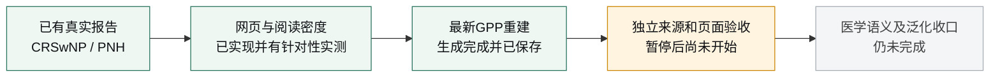

# 无损暂停交接｜2026-10-28｜D22 与阅读密度修复

当前状态：**用户明确要求暂停，停止后续派发与实施。** 本次最后一条真实重建已自然结束，恢复从新报告审阅开始。不要重新检索、重新生成或等待旧 PID。

## 1. 当前入口和版本

先读本文 → [STATUS](../STATUS.md) → [PRD](../PRD.md) → [DECISIONS](../DECISIONS.md) → [PLAN](../PLAN.md)。[EXECUTION_PACK](EXECUTION_PACK.md) 是任务合同，里面的早期环境和采集步骤不需要重新执行。

|内容|当前入口|产品代码与记录|
|---|---|---|
|竞品子系统|[codex/ciw-clinical-endpoint-index](https://github.com/smkzw/competitive-intelligence-workflow/tree/codex/ciw-clinical-endpoint-index)|冻结产品代码 `fe85d129d4fa0ab69584037fcfc8e4e6db195441`；本暂停记录随后提交|
|工作台|[codex/ciw-report-reading-focus](https://github.com/smkzw/protocol-v3-workbench/tree/codex/ciw-report-reading-focus)|阅读实现 `d64f86e40e9be9555f676c9c1c4bf2e57dc9e902`；文档提交 `1c072b1`|
|较早发布基线|CI `codex/ciw-v2-trunk` / WB `feat/ciw-release-adapter`|CI `ef7e846` / WB `36695f6`；不能当成包含本轮最新修复|

本轮没有合并或强推 main，没有重写历史。接手必须明确选择上面的当前候选分支，而不是默认读取较早发布分支。本轮没有接触旧中文工程。

同机私有恢复包以 `pause-20261028T051226Z` 标识，位于本任务已有控制工作区，包含 `manifest.json`、8份SQLite一致性备份和精确本机 `RESUME.md`。本机绝对路径、原件、运行库、完整模型回复和凭据不写入Git。

## 2. 当前产品合同

这是医学经理工作台“证据调研与方案设计”的竞品事实底座，首个项目为 CRSwNP / MG-K10。实现保留 Python、Jinja、原生JS、ECharts、来源CAS、不可变release与current指针。

- A竞品全景、B临床结果、C设计先例为独立中文HTML报告，共享结构化事实。真实数字、图表、同查询表格与来源保留。
- 网页支持输入适应症、可选研究问题、选择报告。D20要求优先深入所选类型；B/C不等待A药物属性，其他类型在同任务按需补生成。
- 适应症差异由YAML表达。中文药名未核实不填，企业/靶点等未核实不猜。自动发现的登记候选不能称为已确认创新竞品。
- 内部只有两个模型角色：DeepSeek主抽取、GLM读取原文与候选核对。核对者并非独立盲抽取，没有第三模型仲裁或签发平台。
- 当前D22：**DGX/deepseek + cms-smk/glm-5.3-flash**。D21临时DGX/glm的真实记录和缓存保持原标识。
- 桌面宽屏、康哲Design近白阅读底、橙色当前/主操作、正文与数据16px。用户要求纵向密度和实际图表信息优先，不靠小字、裁内容或免责声明墙。
- 缺失不补0、不按数组顺序推臂、不将跨试验描述当头对头。登记内部矛盾保留原值，派生角色可保持未知。
- 不恢复v1的PDF/PPT、表格文件导出、门户事实编辑、离线分享、个人视图、定时监测、历史回放、手机、多宿主安装包或24门户矩阵。

历史1007V1/rebaseline-v2/旧Skill/专家审阅是背景和证据，不能恢复已被当前v2合同排除的范围。Goal API本次实查为 `null`，没有伪造创建、恢复或暂停Goal；这里暂停的是用户授权的实际工作流。

## 3. 全局进度

|PLAN里程碑|已经有的真实成果|尚需收口|
|---|---|---|
|M0 环境与隔离发布|v2已建、专用分支已推，源码和规范齐全|最新候选尚未完成发布验收/合入较早发布分支|
|M1 CT.gov与A/B/C|CRSwNP已有真实三类报告与数值抽查；保留真实来源|本轮新分类及跨适应症科学性不能借用旧报告通过|
|M2 工作台|适配器、托管、隔离开发身份、网页入口、当前报告阅读|正式宿主认证部署；最新科学候选的完整消费验收|
|M3 中国来源|已有CDE59详情/75登记、NMPA16详情、官网9篇/公众号3篇记录|本品CRSwNP登记未证实；新适应症中国覆盖未完整|
|M4 两模型|已有真实事件/属性成果，D22已恢复CMS临床调用|新端点映射的逐原文接受情况、失败与待核处理|
|M5 论文|CRSwNP已有3篇、15主要结果/7比较的历史成果|跨适应症论文空缺、检索失败和当前报告内采用完整性|
|M6 泛化/studio|PNH真实运行、CRSwNP设计候选进入studio与选择恢复|更多新适应症、真正多研究语义横比；候选池最新版本再核|
|M7 独立用户LOOP|网页按需生成、补生成复用、密度/草稿/返回实测|原GPP新报告审阅、A身份与公司来源、临床family与数值框收口|

不提供一个凭空估算的整体百分比。当前产品仍未满足整体上线条件。

## 4. 本阶段真正完成的改动

### 4.1 所选报告优先与恢复

D20基础CI `e8707ae` / WB `eb98195` 已实现：首份只深入所选A/B/C，补生成复用完整登记集合、获取日期和已采用事实；只有实际生成的报告开放阅读。补生成或失败时旧报告保持可读；幂等、身份隔离、原子写入和不可变旧快照保留。

早期独立代码审查发现iframe卸载、半文件恢复和返回获取日期三个问题，修复后原审查者复查关闭。后续GPP网页实测验证了只补C、B仍可读、不启动A属性和不重下载54份登记。

### 4.2 阅读密度

详情与两份小截图见 [FRONTEND_DENSITY_20261028](../FRONTEND_DENSITY_20261028.md)。

- 工作台标题、任务选择与操作并栏，新建表单默认收起，研究问题按需展开且入口并入标题行。
- 卡间10px、卡内纵向10px，表格与数据16px。嵌入报告复用宿主导航，截止日移到报告标题旁；独立报告保留完整导航。
- 分类轴按数据量与窗口高度选10/6/4行；大集合通过固定窗口平移访问全部项。小数据图缩短高度。
- 修复真实拖动把94项压进340px的问题；固定窗口移除重叠的缩放手柄。
- 修复730→900→730反向resize不恢复图高；用下一动画帧和visualViewport事件重排。
- B没有实际组间比较时收起空块，单位整词换行；C筛选同时更新矩阵和图表。

真实范围：1440×900独立A首屏从0行产品增至3行，C从5行研究增至6行；嵌入C表起点约提前77px。最终A短屏往返图高228→340→228px、窗口6→10→6项，轴与两组series各101项不变；实际鼠标平移至末类100。MN草稿保留、同iframe节点和真实浏览器历史Back通过。

不同截图对应不同呈现候选，详见密度文档；没有把它们拼成最新代码下全部页面/全部尺寸均通过。

### 4.3 来源章节、医学索引和角色

- C按入排、终点定义、实际给药期限分别索引；100周治疗、104周暴露与另4/16周末次给药后随访保留为不同原句，条件性再治疗与完整上下文仍可展开。
- 临床索引按唯一标题/定义处理，复用现有两个角色；保留原文、数值/比较符、来源定位和失败记录，实际结果不被计数字样直接静默吞掉。
- 当前人工配置优先于来源索引，来源索引优先于检索前provisional词组；旧计划的识别含方向/域，避免按ID误认人工规则。
- 已关闭被独立审查发现的中/英/混合语言标签绕过：连续测量不能借定义中另一句缓解标准被改名为“组织学缓解”。只声称已检验的中文/英文反例，不声称通用多语言保证。
- 原GPP NCT03782792的Placebo确实在原登记里也是EXPERIMENTAL。新规则保留原type/名称/源，在全部干预明确仅为Placebo而类型矛盾时派生role=unknown、记录逐臂冲突。没有猜改成PLACEBO；活性药+Placebo不降级，论文D18自己的明确分组保留。
- B搜索数字边界已修复，Week1不卷入Week12/16或1.5；括号/Sub-score排版变体可查。通用统计形式写“比例”，0.543和原单位不自动变成百分数。

独立代码审查已经按反例关闭上述特定索引/角色/C章节合同，不能代替新报告内容的独立科学接受。

## 5. 模型切换经过与实际证据

1. CMS证书过期导致原GPP attempt1/2在规划阶段失败。用户授权排查；Omni Router三个鉴权实际共用同一过期上游，均出现证书错误。没有关闭TLS或改全局路由。
2. D21由用户明确临时切DGX/glm。原attempt3自然生成B，真实别名GLM-5.3-Flash-EXL3；该次核对耗时441.252秒，整次约524秒。原DeepSeek规划缓存保留其真实别名。
3. D22用户确认cms-smk恢复并要求切回。无临床内容探测返回glm-5.3-flash/stop/非空OK，3.278秒；主抽取始终为DGX/deepseek。
4. 当前同源B重分析已出现真正临床任务回执：新增DeepSeek8条、CMS-SMK GLM14条。旧DGX记录没有改标。

当前内部角色仍为两个家族。外部独立测试者仍是用户指定的Pi/openai-codex/gpt-6-luna（请求max/priority，观察到同名模型）和Pi/cursor/default（底层型号/effort未暴露）。没有将连接探测当成临床接受，也没有声称看到未暴露的权重身份或effort。

## 6. 恰好停在哪里

### 原网页GPP项目，已经完成的操作

同一job `research_7701a57b41dc9c90eb55`：

|尝试|产物与范围|验收结论|
|---|---|---|
|1/2 CMS|证书过期失败，保留记录|FAIL|
|3 DGX / CIabb167a|B `rel_0f41f318e989ae24`，54来源/481结果|独立已打开并核对；整体PARTIAL|
|4 新代码补C|B+C `rel_9e81f478fbbec046`，不新增登记、不跑A|复用/补生成成立；B临床问题仍0，搜索/角色问题未关|

最后一次同源回归由原Cursor在**完整私有副本**运行公开命令 `ciw research ... --report B --reuse-research`。不是owner代做，也没有改原网页项目。

### 最新副本：恢复时第一件事是审阅它

|项|实际值|
|---|---|
|代码|CI `fe85d12`|
|开始—完成|2026-10-28 04:05:41—05:10:18 UTC，约64分37秒|
|current|`rel_71434bce326c5842`|
|release.json SHA-256|`f8968a70825aac51aafc59b75388512f786d2139a2152a824cb230b720d0b3e3`|
|来源/研究/登记候选/结果|54 / 54 / 41 / 481|
|临床映射/问题/历时序列/C行|68 / 317 / 22 / 23|
|问题组织|317个问题均只含1项研究，**多研究横比尚未因此实现**|
|当前队列|6条endpoint_index_needs_review、1个endpoint_index_failed、1条arm_role_conflict；失败记录可能涉及一批描述，不能把8条记录说成仅8个事实未解|
|数值完整性只读对照|result_id集合和54来源集完全相同；原数值、N、区间、单位、分析人群、时程、原文和来源定位差异0；317条domain/concept及16条groups发生预期派生变化|
|尚未执行|本新release的独立audit/逐原文科学审阅/浏览器与图表审阅|

这是**生成完成、待独立验收**。317个问题的数量不构成临床质量证明，不能用它替代真正的相关研究分组与横比。

该CLI父进程55347已经退出，持久状态done，内核NOTE_EXIT等待也返回完成。不要等待或恢复旧PID，不要再次生成。Cursor前一条报告仍写PENDING是因为它写于后台生成完成之前；以本暂停时查明的实际产物更新恢复判断。

## 7. 验证范围与资源保存

|验证|结果|真实范围|
|---|---|---|
|CI全仓开发门|280 passed，3.62秒；Ruff全绿|fe85d12，离线单元/合同，未替代临床或浏览器|
|工作台|7组件测试、生产构建通过|阅读实现；既有App重复title和大包警告未修|
|独立科学代码收尾|30个focused cases与生产函数反例通过|fe85d12的特定标签/比例/搜索；不是真实分类接受|
|实际密度/草稿/Back|上述特定候选范围通过|真实已有研究的呈现副本，旧源不改|
|原GPP网页新current|audit40 errors=[]|rel_9e81f478fbbec046；不能挪给新rel_71434bce326c5842|
|新副本数值/来源差异|0个核心数值/上下文差异，54来源一致|owner暂停核查，尚无新的独立内容接受|
|暂停一致性备份|8份SQLite integrity_check=ok；最新54个CAS内容哈希一致|私有暂停包，不包含凭据，不入Git|

本轮新发出的研究/模型请求已自然结束，没有为暂停丢弃正在返回的答复。保留本地查看服务和既有权限，未新增自动运行；恢复先核服务是否仍在，不盲目启动重复实例。旧重度哮喘任务的完成证据仍不足，单独保留未决状态，不纳入本轮通过。

同盘备份用于防止错误续接；跨机仅clone源码无法还原私有原件和模型缓存。跨机接手需要转交私有运行区，凭据另走环境变量，不把它们塞进源码包。

## 8. 深度复盘

### 能生成、能对上原值，仍不足以交付

此前多次audit40无错，仍暴露临床分类、角色、时间语义和横比组织问题。最新481条原数值完全保留是必要成果；317个单研究问题说明研究组织仍没有达到用户要的一眼横比。下一阶段的关键不是继续增加问题数量。

### 阅读密度的根因在内外两层

最初只改卡片padding不够：工作台新建表单、重复研究问题、宿主导航和报告内部导航叠加。实际嵌入截图揭示这些空间消耗，最终保留任务能力并收掉重复chrome。固定图高也会同时造成小数据空旷和大数据堆叠，所以按可见窗口取高，同时保留完整数据与可操作平移。

### 独立测试者也需要验证其证据

旧MN截图停在新建表单，不能证明报告审美；隐藏图实例仍有旧option，不足以判定可见残图。owner查看了实际截图和源代码后，既修真实问题，也没有照单接受错误推断。初次隔离预览因owner启动漏app路径失败，真实失败保留；修复后才完成嵌入核验。

密度复验分成了多个有界节点，有些节点在工具预算内没走完草稿/Back。后续应减少重复读背景，先完成动作，使用正确导航上下文和真实滑块几何；不要再将同一页面全页审查变成无限轮转。

### 快速探测不能估计真实任务时长

CMS连接探测3.278秒；这次真实B重分析64分37秒。新增8条DeepSeek调用累计约1698.7秒，中位163.5秒、最大594.1秒；14条CMS调用累计约2169.2秒，中位99.4秒、最大390.3秒。不能把全部等待归因于一次模型冷加载，也不能把14条CMS调用全部当作14个独立接受结果。

下一步先利用现有回执区分正常批次、纠错重试、长上下文与服务排队；保持两角色和质量，优化唯一描述分批及失败修正范围。不要先降模型、降标准或再加一层会商平台。

### 原始来源也会矛盾

GPP的Placebo类型矛盾来自原登记，不能为迎合审阅意见强行翻转，也不能无说明地继续叫试验药。当前保留原来源与逐臂冲突。新临床映射本身也需要接受审查，两模型返回成功与中文标签正常均不足以自动证明含义正确。

## 9. 未完成的交付条件

1. 新GPP副本的科学内容、图表、来源和角色独立接受；6待核/1失败批的实际范围与补救。
2. 临床family、相关研究集合与数值共轴资格分开：317个单研究问题不能当正向多研究横比。
3. EoE真实DSQ/组织学来源恢复与MN完整条款重建后的浏览器接受。代码反例通过只关闭代码合同。
4. A的品牌别名、背景/组合/安慰剂候选、创新属性、企业角色与批准来源；Phase IV不能擅自证明该适应症已经获批。
5. SAE复合随访窗口被收成单周等时间语义问题；GEMINI组别绑定等尚未解释的来源差异。
6. 新适应症中国来源及关键论文；公司/MAH无可靠依据时保持空或未知。
7. 正式宿主身份部署与最新同一候选的完整工作台/studio消费验收。

## 10. 用户解除暂停后的唯一安全顺序

1. 显式定位英文候选工程，核对HEAD/工作树和本机暂停manifest。源码可能有后续提交：逐项diff，不回退。默认cwd可能指向旧中文工程，不能盲用。
2. 读取私有 `RESUME.md`，确认新副本current仍为rel_71434bce326c5842、SHA匹配、DB可读、没有新的健康运行。正常数据库不回灌备份；新报告存在就**不重建**。
3. 续接原Cursor会话 `01a17fe2-d3d5-7000-baf0-7c73f9db837c`，仅审阅该新release：先audit40、逐原文抽查，接着真实B/C页面、临床问题/时点搜索、GPPGA脓疱与总分、角色冲突、0.543原比例与原单位。完成此前没做的验收，明确这是同源回归。
4. 逐项处理6待核/1失败批，保留成功原件/缓存；正常源按内容、schema、规则键复用，不因改展示全清缓存，不强制重放所有模型调用。
5. 针对真实family和比较框组织做一个完整根因批，再一次相关回归；不要只把中文标签相同当等价，不按Top-N截研究，不为测试造额外刷新平台。
6. 来源根因批冻结后，再安排下一不同适应症/问题/报告组合。准备过的冷凝集素病C→B尚未派发，可作为候选；两指定测试者保持实际用户操作，owner仅统筹修复。一次仅一位占用Ego。
7. 继续收口A身份/中国来源/论文与正式认证。阶段真实条件满足再整块更新STATUS和推送，不提前宣称RC或上线。

用户没有要求接管者重新确认D20、D22、Ego专用空间权限或已批准的产品范围。只在新的重大用户事实/范围冲突确实无法安全解决时使用原生选择题。
