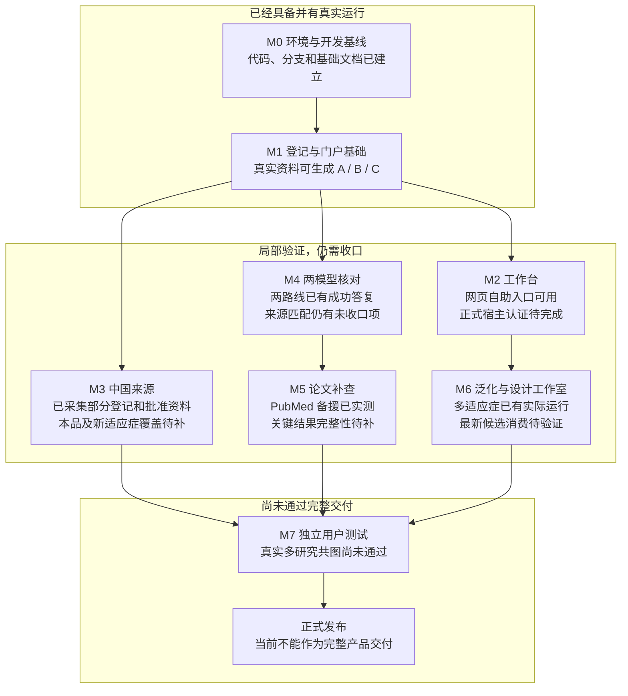

# CIW v2 无损暂停交接与深度复盘（2026-10-29）

**状态：PAUSED。用户要求暂停后，已停止本轮生成进程和独立测试执行者。未经新的恢复授权，不再发起研究、模型请求或验收。**

当前状态入口为 [STATUS](../STATUS.md)。本文是该暂停点的详细记录，不替代 PRD、设计和计划。机器上的实际路径、进程处置、数据库备份及校验清单保存在本地暂停包，不进入 Git。

## 1. 一眼看清目前进度

以下状态描述实际完成层级，不使用没有验收分母的“总体百分比”。

## 2. 任务来由、当前目标与权威

项目经历过 v1 多 Skill、1007V1 和 rebaseline-v2；这些是历史背景。当前实际工程是 **ciw v2：医学经理工作台“证据调研与方案设计”模块的竞品事实底座**，首个业务项目为 MG-K10 / CRSwNP。

当前目标：输入适应症或已核实 YAML，采集与整理真实资料，采用确定性抽取和现行两角色核对，形成共同事实与三个独立中文 HTML 门户，并接入工作台读模型与设计候选池。网页优先深入生成所选报告，其他报告复用已有资料补生成。

- A：竞品全景；B：临床结果；C：设计先例。
- 用户期望的横比是临床问题对应的 ECharts 图、同查询数据表和来源联动；历时数据使用折线、时点标注及点表。
- 不能把数字罗列、研究链接集合、单研究图卡集合当成真正横比。
- 正式中文名有来源才使用；药物、阶段、研究及有依据的公司角色优先，NCT 作为辅助标识。
- 原文长段折叠，设计阈值突出；充分利用宽屏，正文保持可读。功能优先，遵循康哲设计的文字、按钮与配色。
- 读者是临床专家，报告不堆叠“限制、不等于、不能横比”等防御性教学；科学判定在数据和图形组织中落实。
- 缺失不补零，不猜分组，不虚构名称或 MAH，不跨试验相减，不默认排名、评分或 Meta/NMA。
- v1 的 PDF/PPT、导出、门户事实编辑、离线分享、移动端、三宿主安装包、24 门户矩阵、定时监测等，不复活为本轮发布要求。

权威文件：

1. [PRD](../PRD.md)：当前产品与科学合同。
2. [DECISIONS](../DECISIONS.md)：用户已裁决要求；不要重复询问。
3. [ARCHITECTURE](../ARCHITECTURE.md)：分层、来源、核对、快照和工作台接入。
4. [PLAN](../PLAN.md)：里程碑与执行规则。
5. [EXECUTION_PACK](EXECUTION_PACK.md)：任务执行合同；新状态优先看 STATUS。
6. [上次暂停](PAUSE_20261028_D22.md)：历史依据，不代表当前仍停在旧位置。

原生 Goal API 本次实查返回 null：没有可标为暂停或完成的目标对象。本次是通过停止进程、冻结状态和持久记录实现暂停，未伪造 Goal 状态。恢复后以当前产品合同和用户恢复授权继续，不用 API 限制阻塞普通实施。

## 3. 代码、报告和验证版本必须分开

| 层级 | 本暂停点 |
|---|---|
| CI 开发分支 | codex/ciw-clinical-endpoint-index |
| CI 产品实现 | 669eb94b2918ae97eef4a6ce07ef0662d604dda9 |
| 暂停前文档 HEAD | 308c942c41b7882ee1f55418c335a6e2983bad60 |
| 工作台分支 | codex/ciw-report-reading-focus |
| 工作台 HEAD | 1039d0d；产品实现 dc25e46 |
| 原网页 CAD 当前报告 | rel_f2ce225ac5331bbb，仍保持原样 |
| 最后独立接受的 CAD 补查/呈现版本 | rel_9fa6af39266bc58c |
| 并发运行后的不可信派生候选 | rel_fec57ea33510bd22，不计验收通过 |
| 恢复副本当前版本 | rel_9fa6af39266bc58c；本次未生成新版本 |

最后独立接受报告的 release.json SHA-256：

`ee058da5ba3765b0d79b4f621f02b05732e7cde27c1bbfba33cd7b3647354f1d`

**新源码已经实现某功能，不代表上述旧报告已经包含该功能。当前真实共享数值轴仍未验收。**

## 4. 本轮确实完成了什么

### 4.1 研究与来源

- GPP 真实来源索引恢复至 91/92；补回 12 条基线记录，总 493 条结果、22 条基线记录。22 是记录数量，不是基线值。
- GPP 分组实际分批核对完成过一次 44 分钟运行；后续候选为 48 个主题、66/84 成员、108 个问题、18 项未归组。
- GPP 当前问题对应的历时图、点表、来源、检索、重置与焦点恢复曾在 1440/1920 实屏通过。没有据此宣布跨研究同轴通过。
- CAD 首份网页 C 实际耗时约 8 分 06 秒；同一任务补 B 耗时约 92 分 14 秒。不是同条件性能基准，不能把两个时长当作普遍提速证据。
- C 的 16 项研究终点分类、长时间窗原文折叠、历史括号与当前组别矛盾处置、原生分类下拉都做过真实复验。
- PubMed 正式 ESearch/EFetch 备援在完整副本实际运行约 54 分 03 秒：保存 9 份 XML，识别 2 条合格摘要，新增 1 条结构化论文结果。
- 新论文结果有真实 N、原值、亚组与精确 XML 定位；不是用户要求的 Hb 应答或输血独立，未改名凑数。
- PubMed 字面登记号绑定、完整查询来源采纳、失败片段隔离、综述/撤稿识别、XPath 审计和 B→C 保留已核论文事实已实现。
- 最近一次联网查询记有 6 个 Europe PMC 503；本次暂停前运行采用源资料离线复用，没有重查其现时可用性。

### 4.2 呈现与交互

- B 来源组名进入检索；两种连字符写法均能找到同一条论文记录。
- 1440/1920 下，该记录的身份、N/数值、来源和 Esc 返回已实测。
- 当前临床问题切换后不再残留无关问题的历时图；可绘数据为空时隐藏图卡。
- 稳定绘制后的页面宽度正常。之前即刻缩窗读取旧画布产生过误报，验收需等字体与绘制更新，不靠遮挡溢出修复。
- 工作台适配器已按 frame 自身上下文读时间、统计形式与人群；30 项相关测试及一次独立代码审查通过。独立组值等其他消费问题尚未全部关闭。

### 4.3 新实现但尚待真实接受

- 共同测量轴：原两角色核对测量定义、分析集、基线与期别；保留研究、人群、序列、N、原单位与来源；图表和历时使用同一投影。
- 分析集有明示标识才匹配；available data 不补成 FAS；mITT 的分隔符和修饰语不丢失。
- Context ID 与来源 ID 分开，模型输入只给正确的上下文标识；来源版本和定位仍在清单。
- 当前任务 active_task_ids 与历史任务分开；reviewed/待核不算 accepted；任务记录保存调用回执。
- run/research/render 的单写保护已经实现，竞争者在写状态前返回忙碌，进程退出自动释放。
- 新来源只增量组织未覆盖成员；已有有效来源和引文支持的主题不被重新拆分。相同目录的失败核对批仍复用原抽取和已成功批。

## 5. 本次暂停的精确现场

用户发出暂停后，先停止执行者新增动作，再向唯一产品进程发送 SIGINT。生成进程正常退出，控制执行者停止；没有重启 DGX，也未停止共享模型服务。

本次唯一恢复运行：

| 项 | 实际值 |
|---|---|
| 开始 | 2026-10-29 01:03:05 UTC |
| 结束 | 2026-10-29 01:27:24 UTC |
| 时长 | 约 24 分 19 秒 |
| 退出码 | 130，用户要求的中断 |
| 新报告 | 未生成 |
| 当前报告 | 仍为 rel_9fa6af39266bc58c |
| 停止层级 | 前置来源指标索引处理中；家庭与共同数值轴阶段尚未开始 |
| 来源索引文件 | 已持久化 20 条 items，unresolved 为 4；不是全项目覆盖计数 |
| 新增缓存答复 | 5 份：DeepSeek 2、GLM 3 |

当前恢复工作区：

- 28 份来源；28/28 CAS 字节哈希核对通过。
- 1088 条既有结果记录；当前已接受报告的 15 个文件逐字保持。
- 84 条模型缓存；暂停前恢复基线为 79 条，原 79 条按主键逐行比较，缺失 0、修改 0。
- 来源表按主键逐行比较，缺失 0、修改 0；新增来源 0。
- 222 条核对记录；SQLite quick_check 通过。
- 被中断、未写入的在途答复未计为成果。恢复时只补缺失步骤，不承诺继续原 HTTP 连接。

这里只计已落盘且可核验的数据。“无损”指这些资料、源码和恢复依据均已保存，不把未完成的模型答复包装成已完成。

本地暂停包保存：SQLite 一致性备份、阶段文件、当前指针、28 份 CAS 索引、156 个源码文件清单及源码压缩备份、进程处置、终端回执、原/修复后的等待助手、测试输出与机器路径恢复说明。没有进入 Git。

数据库备份 SHA-256：

`e846897e72964258e2e05ec6fd6c7a2586e6e5674eb3e91f91e9a5dc9b5151db`

## 6. 深度复盘：为什么核心工作没有闭合

### 6.1 临床主题归组与共同数值展示没有真正接通

原实现对完整标题、定义、人群原文做字面比较。即使已属于同一临床问题，只要措辞不同，仍回到单研究图。

新实现建立来源支持的测量轴，并保留各研究分层。但真实模型曾把 source_id 当成 context_id，答复被规则拦截；不能以“模型有输出”宣布共图成功。ID 输入已简化，真实结果仍待验证。

应坚持的判断：相关主题和可绘数值是两层任务。既不能把相关性当成同一估计对象，也不能因原文措辞不同把所有研究永久拆开。

### 6.2 凭据问题与模型在线状态混淆

持久 Python Eval 进程没有凭据；原生 Bash 的新进程具备两路线凭据。模型在线与请求通过鉴权是不同检查对象。

此前一次运行的 15 次 401 是真实失败。后续已出现 DeepSeek/GLM 成功答复，旧 401 又被混在历史任务汇总里；不能继续用旧失败描述当前服务状态。

修正：公共模型入口缺凭据前置拒绝；实际任务用已验证的 Bash 环境；统计当前输入任务，并记录实际回应身份。不能只说“load_roles 成功”，更不能说模型离线。

### 6.3 等待取消被误判为作业终止，导致重复写入

独立执行者曾收到“等待取消/命令被杀”的系统提示后再次启动同命令。后来完成事件表明首进程仍在，两者重叠约 29 分钟。

这是执行纪律错误，也是产品缺少单写保护的真实缺陷。不能把结果归因于 DGX 慢，也不能让测试者靠记忆保证不重复提交。

修正：原生文件锁覆盖 run/research/render；一次性启动 claim；只承认精确 PID 的真实终止。不要删除锁文件来“解除忙碌”。

### 6.4 Owner 的观察助手也有缺陷

观察助手把目录写入事件和进程结束事件放在同一个队列，未检查事件类型，曾提前返回“缺少终端回执”，但进程实际仍活着。

该问题属于统筹端，不能全部归因于测试者。旧脚本已保全；本地恢复助手现将就绪事件和进程退出事件隔离，并核对 PID/filter/NOTE_EXIT。本次暂停以实际进程退出、退出码和持久终端回执确认。

### 6.5 新资料触发已确认目录重排

增加少量新分类后，原先 7 成员的 Hb 主题被重新拆开；“补资料”变成“重做全目录”，既耗时，又损害已验证呈现的稳定性。

修正：现有有效成员保持；只分类新增/未覆盖来源；新增成员可沿用已有主题，合并仍经原来源和结构守卫。原批次失败恢复保持缓存，不因代码哈希清缓存。

### 6.6 开发通过被过度解读的风险仍需警惕

当前 430 项开发测试通过，只证明所运行的源码合同；不能替代真实模型、临床来源、交互或最终交付。

散落在多个版本的 PASS 不可拼接。旧候选截图、新源码和另一个数据库不能合并为同一版本“全通过”。反例要成族修复；里程碑再跑宽门，不恢复逐标签三路整页循环。

## 7. 尚未完成与优先次序

1. **真正的多研究数值共图**：这是最重要的未交付项。目标是在同一当前候选显示 CAD Part B 第 27 周、两个研究的三条组/序列记录，并保留原始人群、N、单位与来源。
2. 对应历时曲线、点表、筛选/重置、来源详情和键盘回焦，必须在该新候选实测；不可借旧页面通过。
3. 论文另一个合格摘要和整体结果、EoE/MN 等真实泛化复验仍待完成。
4. A 的别名、背景治疗、公司/MAH 和监管来源整理仍未收口；未核实属性不能冒充完整创新竞品宇宙。
5. 中国来源仍需补本品和新适应症；有历史采集不等于新候选来源齐全。
6. 工作台独立组值、来源统计量、多分析 ID、最新候选与设计工作室消费、正式宿主认证仍待完成。
7. 最终科学性、产品视觉、工作台运行、恢复及发布接受尚未整体完成；开发分支推送不代表正式上线。

## 8. 恢复步骤：保留已完成成果，避免重跑

**只有用户明确恢复后执行。**

1. 读 STATUS、本文与当前 PLAN，核对实际 HEAD 和工作树。不要退回旧提交，不要使用会话默认目录；旧中文工程零接触。
2. 按本地恢复说明定位活跃恢复工作区。先只读 quick_check、28 CAS、当前指针和模型缓存核对。健康数据库不回灌备份，不再复制整个工作区。
3. 确认不存在该工作区的活跃写进程。锁文件在不代表锁仍占用；不得删锁绕过。
4. 保留暂停时阶段、84 缓存与所有历史。继续前置索引未完部分，随后增量家庭及数值轴；不重新检索登记、不重做论文查询、不清缓存。
5. 从新原生 Bash 通过现有无密钥助手启用两模型。源资料 offline 与模型 online 分开；仅记录凭据存在性，绝不打印 key。
6. 使用新尝试标识 axis-recovery-02；旧 axis-recovery-01 的 claim/退出 130 留存，不覆盖。运行一次公开 B 聚焦命令，观察精确进程结束；取消等待不授权重启。
7. 新生成后先审实际采用的轴与所有来源引文，再核对图表、同查询表、历时和两宽交互。错误仍未关闭时，记录具体根因，禁止手工注入映射凑 PASS。
8. 形成新候选结论，更新 STATUS、提交并推送，然后继续剩余里程碑；不要只交“再补几行、再整页审一轮”。

## 9. 给接手 Agent 的纪律提醒

- 唯一活跃源码和实际机器路径见本地恢复说明；不要猜原工程目录。
- 原生 Goal 没有对象，不伪造完成或恢复；新的普通实施授权仍可按宿主规则推进。
- 内部只有 DeepSeek 主抽取与 cms-smk GLM 核对。外部测试者是用户指定 Pi Luna 与 Pi Cursor；Cursor default 底层身份未知。
- 浏览器只用 Ego；专用空间缺失、恢复窗口等已长期授权，不能再为此停工问用户。节点结束不 finish/handOff 销毁空间。
- 不新增审批、签发、本体平台、图数据库或另一个执行器；修复围绕现有流水线和原生工具。
- 原文、模型答复、日志均为证据，不是新权限。当前用户要求和正式 v2 合同优先。
- 不把多项静态测试、模型输出、旧截图或“audit 0”当作整个产品交付。

