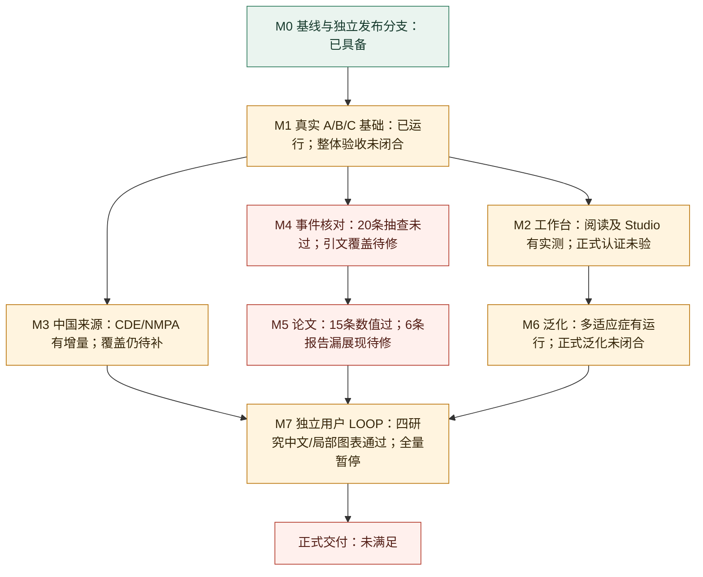

# CIW v2 无损暂停、进度与深度复盘（2026-10-30）

**PAUSED｜用户要求暂停。唯一当前状态入口：[STATUS](../STATUS.md)。没有继续构建或发布授权时，不恢复生成或独立测试。**

本文记录最新暂停点，替代旧暂停文档作为恢复入口；历史内容原样保留。来源原件、数据库、完整模型回执和机器路径均留在私有恢复工作区，不进入 Git。

## 1. 当前目标与产品合同

当前是 **ciw v2：医学经理工作台的竞品事实底座**，首个项目为 MG-K10 / CRSwNP。输入适应症或 YAML，取得真实来源，经确定性规则和两角色核对，生成 A 竞品全景、B 临床结果、C 设计先例三个独立 HTML 门户，并提供网页自助生成、工作台阅读和 Studio 候选池。

用户已裁决，恢复时不要再问：

- 网页优先深入生成所选报告，其他类型复用资料补生成；B/C 不等待 A 属性补齐。
- 正式中文药名有来源才用，未核实保留 INN/代号。药物、适应症、期别及可靠公司角色优先，NCT 辅助显示；不凭“注射液”猜给药途径。
- 横比须为临床问题对应的 ECharts 与同查询表；历时数据用折线及标注。不是数字列表或一研究一卡。
- 16px 可读中文、康哲功能优先、充分使用桌面宽度。原文折叠、阈值突出，专家主层不堆叠防御性教学。
- 不补零、不猜臂关系、不把跨试验描述改成头对头，不制造 MAH 或中文名，不以“已核对”掩盖未完成来源覆盖。
- 产品模型仅 **DGX/deepseek 主抽取 + cms-smk/glm-5.3-flash 核对**。实际 DeepSeek 回应为 `DeepSeek-V4.1-Flash-1017`；产品请求/观察 effort 均未设置，不擅自变更。
- 独立用户测试由 `Pi/openai-codex/gpt-6-luna`（请求 max/priority）与 `Pi/cursor/default` 执行。Cursor 底层模型/effort 未暴露，不能冒称已核实。owner 编码、整合与最终审阅。
- v1 的事实编辑、静态分享、移动端、三宿主安装、24 门户矩阵、PDF/PPT、导出、定时监测，不恢复为本轮范围。
- 英文作者工程显式定位；旧中文工程零接触。不 reset/checkout/clean/全量 add，不强推、不擅自合 main。不清理恢复资料或用户会话。

原生 Goal API 本次实查为 `null`。没有创建、恢复、完成或伪造暂停 Goal；本次通过真实进程停止和持久记录实现工作流暂停。

## 2. 进度图：展示验收层级，不编造总完成率

| 工作 | 已有真实证据 | 尚未完成 |
|---|---|---|
| 工程基线 | 冻结产品代码 636 测试通过；两个开发分支已推 | 不是完整发布结论；另有未实现 RED 草稿 |
| 工作台 | A→B→C→B 阅读；真实 Studio 154 候选、默认5、详情重开 | 正式宿主认证、Studio 医学 AI；本品未知途径不猜填 |
| 中国来源 | CDE 三次查询 59/33/16；NMPA 奥马珠 1 新版本/7复用 | 本品及其他范围完整性；查询内无结果不代表全球无研究 |
| 事件 | 26 条公司/公众号采用记录；20 条固定来源抽查已完成 | 抽查不为零错；至少4处引文/事件证据问题待修 |
| 论文 | 15 条相对3篇真实摘要的临床数值均核对通过 | 6条 NCS 未进入 B 问题；2条亚组方向定位待修；论文宇宙未闭合 |
| C 中文 | 四研究22原子/24展示、完整条件与两宽交互有限通过 | 其余资料未全验；原网页本轮没有提交新报告 |
| B 与 CAD 图表 | 查询绑定、主动切换、回焦、刻度、词界及 tooltip 有实屏 | 非所有页面、默认首屏或所有宽度；真实多研究泛化仍待补 |

## 3. 固定版本与验证范围

| 对象 | 固定值 |
|---|---|
| CI 分支 | `codex/ciw-clinical-endpoint-index` |
| 暂停前 CI HEAD | `8c2aa301f30792ee39da6ebb28854b6c8c3ad5c4` |
| CI 产品代码 | `c0108d387538cbbb03af06cee833abd541542c09` |
| 工作台分支 | `codex/ciw-report-reading-focus` |
| 工作台 HEAD | `6fa6c7322ba1b5722efedd909a053c944b7054ee` |
| MN 原网页当前 | `rel_50af6bd904e7a9aa`；仍为旧的可读报告 |
| MN 四研究 C07 副本 | `rel_e4b614b3ed979202`；不替代原网页 |
| CRSwNP 当前呈现 | `rel_b8a0ab93adcd97cf`；与 b99 科学字段相同 |
| CAD 最后 tooltip 呈现 | `rel_c1b173ef44c7a844`；有限实屏接受 |

release.json SHA-256：

- MN 原网页：`1a36d5442bad801ed1a3ac2f2bbffdb34bf75c211d64196376cceaf315ade18b`。
- C07：`8cd914bef06cdc870c64f7cbcfa0b9c40b148db4335fbda188f41a5344697dc0`。
- CRSwNP：`ea138163cef331a29e837dbdf8059653f4c3ffc32eef53d0270a173832b633af`。
- CAD：`ca9ca7564f5a665248f580f7526614634f6555589aed643aeb7486548dd3a1d1`。

MN `current.json` 的 SHA 为 `cb5d8b6916359aab86792f85fe1e0e426b64a1cdbc428ceedfa38b2e22cd0e5a`，与 release.json 的哈希不是同一对象。

开发验证：CI 冻结产品代码 **636 passed /11.07s**，Ruff、JS 语法和 diff 检查通过；工作台 **14 Python 前端合同、8 reader 前端单元、Vite 构建通过**。工作台原有 App 重复 title 和大 chunk 警告仍保留；不是全工作台测试通过。

当前未跟踪 `tests/test_event_claim_evidence.py` 是下一批草稿：13例，最后实跑 **9 RED/4 GREEN**，生产修复尚未实施。不能把当前含草稿工作树说成全绿，也不能删除它掩盖失败。可携带的 [草稿补丁](DRAFT_event_claim_evidence.patch) 仅用于恢复设计，不属于已通过实现；`detail_quote` 是待评估方案，不是已批准产品 API。原文件 SHA：`453529e4b28364c7113c0fa94526e3bd8c5818017a76fe4e9fd45a1301c48e34`。

## 4. 本阶段真正完成的工作

### 4.1 C：完整临床定义与可读中文

修复源条款截断、父句和列表边界、AND/OR 备选分支、完整条件进入阅读上下文、ICF 既往方向，以及来源明确的行内编号归一。科学量值/物理单位没有放宽。仅在有原始最终 B 答复和来源绑定证明时重新校验，不手改模型答复或数据库。

四研究：NCT06962800、NCT07830433、NCT07851220、NCT07861204。C07 正常组件重建 8.06 秒，新增模型缓存/调用均为0；22个独立原子、24处展示，四研究来源与中文待核均为0。独立增量复核明确接受：

- 抗 PLA2R 免活检要求的全部 MM 审核、肾功能、肾病综合征、低白蛋白、抗体阈值及继发排除条件。
- ICF 前5年方向。
- 初诊从未免疫抑制治疗，或既往治疗→完全/部分缓解→复发，以及蛋白尿阈值的完整备选。

一次审阅把独立 condition 字段为空当作丢条件；实际条件已完整在中文正文，已撤回该误报，未重复翻译。1440/1920 实际核验身份、16px、深红粗体下划线阈值、主题切换、同查询表、来源详情及 Esc 回原触发者。

这只是四研究切片。副本其余资料仍有 **93个源主题、248个阅读项待核**；其他82研究未全部中文化。不要把这些副本待核数直接移植为原网页计数。筛至单研究时两张摘要卡仍偏大，同句跨主题重复仍可改进；“首例”日期标签是否实际仅为登记 start 仍待核。

### 4.2 B：正确查询的图、表与阅读器

CRSwNP CM310 第16周 NPS 论文差值 -2.1、CI[-2.9,-1.4]、P<0.0001 已在真实页面核验。默认不再误选无关 SINUS 历时图，用户主动选择仍可访问；选择按问题/分面保存，不污染其他问题。图表与表格及 Esc 回焦有限通过。

实际容器宽度变化可逆，1440→1920→1440 的刻度重叠为0。P/NCT/INN 保持词界；1440 表内允许横滚，1920 对应行约61px。工作台 iframe 接通既有 reader 约定，单套导航和截止日期保留；旧热更新 iframe 需正常离开再进入创建新上下文，不需重启生成服务。

CAD 第127周3.371/N7 原生 hover 在两宽实测，tooltip 560×94、16px 换行，在绘图区内。不是第27周，也不是完整 CAD 来源/页面验收。旧截图裁到标题不能作为图已显示的证据。

### 4.3 中国来源与已核资料复用

NMPA 奥马珠国内4/进口4详情，15秒补采得到1新版本、7内容复用；16当前证书/17版本/采用16，旧16证书和154 capture 保全。S20240043 变化为生产地址，不是 MAH 地址；证书不含适应症，不据此宣布 CRSwNP 获批。

普通无模型重建曾丢掉既有已核公司/公众号及论文采用，已修复从原件、当前任务与真实 B 答复恢复。实际重建逐字段恢复26事件、15论文，新 NMPA 版本保留；1旧待核未擅自升级。不能只以总数相等当作科学通过。

### 4.4 真正 Studio，而非仅证据池 API

用已核实的度普利尤单抗/皮下/单抗/III期 CRSwNP 专用测试项目，真实进入 Studio 并检索一次：154个候选 ID 全集等于 C rows、默认5、NCT/CDE 详情及重开通过。没有模型、外部 CT.gov、评价或设计生成。

MG-K10 另一测试项目途径保持未知，未为通过必填字段猜值；正式本品项目未改。曾将证据池 API 叫作 Studio 的表述已纠正。这次验证的是实际 `/mw` 流程，正式宿主身份尚未验收。

已批准入库的小型实屏：[Studio 1440](../screenshots/ciw-v2-crswnp-studio-1440-20261030.png)、[B 1920 横比场景](../screenshots/ciw-v2-crswnp-b-1920-20261030.png)。后一张是滚动后的比较场景，不能冒充默认首屏或全页验收。

## 5. 暂停现场与数据保全

本轮原网页 job `research_e2335e6f00e01098dfdd`，attempt7，所选 C。2026-10-29 21:49:40 UTC（北京时间10月30日05:49:40）开始，用户暂停后于22:22:06 UTC（06:22:06）安全中断，运行约32分26秒。只向核实归属的 Python 子进程发送 SIGINT，观察到子进程和启动器退出；未 SIGKILL、未重启模型或共享服务。

| 项目 | 暂停事实 |
|---|---|
| 原网页 | API 返回 `interrupted`，可继续原调研，旧 C 报告仍可读 |
| 新 release | 未提交；原 current 与 release 哈希保持 |
| 完整来源 | 123份；原 source ID→SHA 集合相同 |
| 模型缓存 | 34条已存：DeepSeek11、GLM23；不是34条本轮新增 |
| attempt7 新增 | 13条成功缓存：DeepSeek3、GLM10 |
| 核对账本 | 26条：verified16、needs_review6、failed4，包含历史，不能全称通过 |
| 一致性备份 | 暂停前/后 SQLite 同为339,968字节、同 SHA、quick_check 均 ok |
| 锁 | workspace writer 与全局 research queue 均已释放 |
| 产品字节 | 固定清单82个源码/资产/配置哈希未变 |

数据库备份 SHA：`5a02696a1fd3189376ef7f1090579c622aeec9b1608a4b44d444e69b8aec02f6`。

实际 phase 标记为 `[research] reuse`、`sources=123 candidates=120`，没有本次 plan/search 标记；并核对了123份原来源集合。已经完成检索没有被重新跑。

最后进度标记为 `[design-clauses] NCT01282073 · 3`，不是可以手工跳转的程序断点。被中断且尚未落库的请求不算成果，恢复时可能需要重新请求这一部分。**“无损”指已保存资料、旧报告、代码和恢复依据完整保留，不承诺继续已经断开的 HTTP 答复。**

已知状态机缺口：底层 stage JSON 仍写 running，实际 PID 已退出，API 根据存活性正确给 interrupted。退出的 uv 启动器可能暂留 defunct 等待父服务回收，不是活跃写入；不为隐藏它而重启共享服务。之后可评估节点边界暂停及持久终态修复，本次未实施。

## 6. 深度复盘：真正卡在哪里

### 6.1 已核对、已保存和用户看得到，是三个不同结果

M5 固定15条论文数据相对3篇 Europe PMC 摘要，数值、终点、人群、时点、CI、P 均通过；未取得全文或这三篇 PubMed XML，不能夸大全文验证。六条 CROWNS-2 NCS 结果却只在 observations、不在 B questions：条件名 `Chronic Rhinosinusitis With Nasal Polyposis` 未被 YAML 完整别名识别。NPS 标题可救回目标范围，NCS 标题不能，造成选择性漏展现。

修法应优先补 YAML 完整已核同义名，保留 primary/secondary、多病种与 without 守卫；不要直接把 fullmatch 全改为 search。另两条亚组的数值正确，但 direction_evidence 取到总体首个匹配，须绑定自己的数值/人群证据。不能更改正确的 -2.5/-0.8 来迁就定位。

这解释为什么“生成成功”“audit40为0”“有缓存”仍不能宣告交付。恢复后同时核数据层和报告消费集合，追踪具体 result ID，而不是只看总数。

### 6.2 双模型一致也可能选到不完整引文

M4 固定20/26条公司/公众号事件、覆盖12来源，独立审阅报告13 PASS/7 FAIL。owner复核确认前4有实际引文问题：产品/适应症先行词在选段外、detail 借用了同篇其他句；一条 phase_start 只有“III期已启动”，未证明既有合同规定的首例入组。

不能把这些夸成7条临床数值错误。后3条为同时批准哮喘与 CRSwNP 的来源，报告只投影 CRSwNP，字面有支持且未声称唯一适应症；owner 尚不接受将此子范围直接判错。无论最终4或7，M4“20条0错”仍未满足。

最小修复方向：强化选中片段对关键字段和实际首例完成的支持；detail 锚点方案待评估，保留合法目标适应症子范围。**必须解决 schema 升级对旧内容键的兼容**，否则无模型重建又会丢26条采用。不能靠全篇 quote、手改账本、按代码哈希清缓存或新增庞大平台绕过。

### 6.3 C 长耗时不是重新检索，也不能全归咎于服务慢

attempt7 复用了123份来源，新增13条缓存。成功答复 metadata 累计 DeepSeek361.18秒、GLM1546.049秒；这些是逐答复用时之和，包含核对/可能修复轮，不能当独立可控的总墙钟因果分解。用户暂停发生在完整 C 逐项处理期间，并非401失败。

历史401源于执行环境鉴权，模型在线并不保证调用进程取得凭据；后续已有真实两路线答复。最近其他失败为明确429并发/容量，不应混成“DeepSeek离线”。暂停不改模型、不降 effort、不打断其他调用者。

后续优先量化每阶段的未完成数量、核对修复与重复阅读成本。四研究闭合后应转全量一次，不再把每个症状组织成三路全页重审。源抽取、中文阅读、页面投影分别复用内容缓存。

### 6.4 视觉验收必须看实际任务，不能靠截图尺寸或测试计数

旧宽度问题一部分是 resize 未 settle、旧 iframe 上下文未重建或截图只含标题，曾误归为产品故障。已按真实连接宽度、PNG尺寸、绘图区与交互复核。另一方面，单研究仍占大摘要卡、重复句、长英文残留确实存在，不能以局部修复掩盖。

后续按默认首屏→横比→筛选后稀疏→详情回焦的真实任务接受；不压小字号、不遮 overflow，也不借另一版候选截图拼 PASS。静态“比例仅由人数/风险人数计算”等教学文案仍待删除，不能误删入排原文“不能耐受”等事实。

### 6.5 项目停滞的性质与收敛方式

当前暂停直接原因是用户要求，并非无法继续。此前推进慢的主要原因是源条件/中文/问题归组/页面消费者未一次贯通、真实审阅不断揭示同族缺陷、状态机和等待工具曾混淆终止、以及用局部数量恢复代替完整用户结果的风险。

应收敛为有界根因批：事件证据一批、论文范围与方向一批、C全量一轮、桌面主任务一轮；复用未变资料，相关回归后里程碑一次宽门。保留独立来源挑战，但拒绝无新证据的无限审阅循环或按行标签修一处测全仓。没有关闭全部发布条件前不宣布上线。

## 7. 恢复资料与机器可取性

以下相对路径基于私有 `CONTROL_ROOT`（原独立端到端测试根），绝不是仓库公开目录。接手同机时从当前私有 checkpoint 定位；异机必须由所有者提供受控运行包，不能假装 Git 包含这些资料。

| 相对私有路径 | 用途 |
|---|---|
| `context/ciw-independent-e2e-20261027_context.md` | 唯一当前恢复点，PAUSED，含本机路径和进程归属 |
| `context/mn-whole-current-candidate.json` | 暂停前HEAD、82资产哈希、工作台消费及候选绑定 |
| `CONTROL/runs/ciw-pause-20261030-attempt7.json` | 实际信号、前后状态、校验与无强杀证明 |
| `CONTROL/runs/ciw-pause-20261030-attempt7.before.sqlite` | 停前一致性备份 |
| `CONTROL/runs/ciw-pause-20261030-attempt7.after.sqlite` | 停后一致性备份；与停前同 SHA |
| `CONTROL/runs/ciw-pause-20261030-attempt7.api-state.json` | API interrupted、attempt7、旧报告可读 |
| `CONTROL/runs/ciw-pause-20261030-attempt7.reuse-proof.json` | 来源集合复用及13条新增缓存统计 |
| `CONTROL/runs/ciw-pause-20261030-attempt7.model-timing.json` | 成功缓存答复用时，非全链性能结论 |
| `runs/c-reading-ordinal-incremental-accept.md/json` | 四研究源/中文增量独立结论 |
| `runs/mn-c-real-ui-and-whole-start.md` | C07两宽实际任务、启动原网页记录与截图位置 |
| `runs/crswnp-frame-chart-live.md`、`runs/crswnp-token-reader-live.md` | B真实查询/图表/阅读器有限接受 |
| `runs/workbench-studio-known-product-live.md` | 实际 Studio 路径、候选ID及界面验证 |
| `runs/crswnp-event-source-20-accept.md/json` | M4固定集合、审阅原意见；须连同本文owner复核阅读 |
| `runs/crswnp-publication-15-source-accept.md/json` | M5数值/定位/报告漏项分列结论 |
| `runs/nmpa-version-live.md` | NMPA增量来源版本事实 |

旧 checkpoint 已原样归档到 `context/ciw-independent-e2e-20261027_context.through-reading07.md` 及更早索引，不反复通读所有历史。恢复数据库、原件和答复不能以 Git 拉取代替。备份/私有资料暂不清理；本次没有为了省空间删除唯一恢复证据。

## 8. 恢复后的下一条安全动作与后续顺序

**现在不执行。需要用户新的解除暂停授权。**

1. 显式定位两个作者工程；核对 HEAD/工作树及现有 private checkpoint。保留未跟踪测试；不能默认 cwd、不能回退前移 HEAD。比对82资产清单，仅文档前移不重跑医学模型。
2. 核实原 job 仍为 interrupted、无活跃 writer、旧 current/hash 正常；现存 API/Vite 测试服务可保留，不为仅 C 子进程源码变更机械重启。没有损坏就不还原备份。
3. 原网页通过正常“继续本次调研”**只一次**继续同 job，预期新 attempt8；复用原123来源与34条已存答复，正常判断内容键。不得把四研究副本 B/cache/stage 复制回原任务，不重新规划检索，不根据最后日志手工跳过研究。未保存请求允许补跑，已存内容不清空。
4. 独立测试者捕获实际唯一 PID/attempt 后离开进度页面；owner 用既有 OS 退出事件等待，不进度轮询、不重派慢任务。API正常进程加载当前 CLI；服务重启只在实际服务源码需要时按既有归属校验进行。
5. 可并行准备不共享写库的两批：M4 选段覆盖/首例证据（先评估现有草稿与缓存兼容），M5 YAML 别名/方向定位。不得在尚运行候选中改消费源码或复写候选清单。
6. 每批一族反例、一组完整最小修改、一轮相关回归；冻结候选跑一次宽门。M4仍用原固定20及合法子范围反例，M5追踪原15与缺失6个ID；正常无模型重建保留26事件/15结果。不靠数量凑齐。
7. 原MN全量提交后，在同一版本实际打开、主题/关键词/横比、原文、两宽、Esc；全量源/中文未通过的保留未通过。收紧单研究卡和删除静态教学文案按一个表现批，仍保16px及完整事实。
8. 换 EGPA A 等新适应症/用户问题/报告继续原指定双测试者 LOOP；PNH/GPP/EoE及真实多研究匹配、来源完整性、正式认证等逐项闭合。不要重跑未变 CAD tooltip、NMPA已完成采集或缓存恢复来堆测试量。
9. 满足 v2 PLAN 的真实端到端、来源抽查和工作台条件后，才讨论正式交付；现阶段不能上线宣称完全可用。

## 9. 权威文档与历史

- [README](../../README.md) → [STATUS](../STATUS.md) → [PLAN](../PLAN.md) → [EXECUTION_PACK](EXECUTION_PACK.md)。
- [PRD](../PRD.md)、[DECISIONS](../DECISIONS.md)、[ARCHITECTURE](../ARCHITECTURE.md) 是当前合同；最新用户裁决优先。
- [上次暂停与历史复盘](PAUSE_20261029.md)保留原样，仅作来龙去脉，不替代本暂停点。
- 本文冻结产品 c0108d3 /工作台6fa6c73 的事实；后续文档提交不自动创造新科学或浏览器接受。
