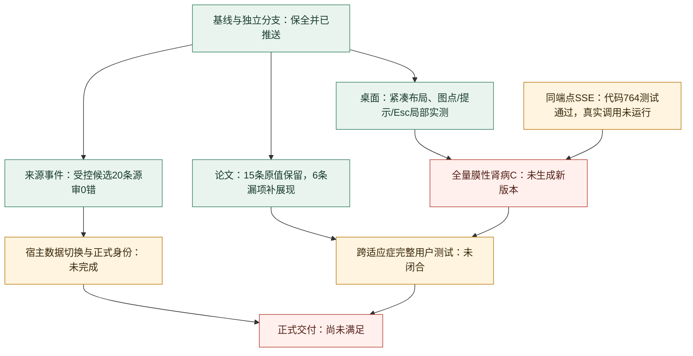

# CIW v2 无损暂停与完整增量交接｜2026-10-30｜SSE 接入后

**PAUSED。用户要求无损暂停；不得从本文件自动恢复模型调用、网页生成或独立测试。**
唯一当前状态：[STATUS](../STATUS.md)。本次之前的完整背景见[上次暂停交接](PAUSE_20261030.md)，该历史文件未改写。

## 1. 给接手 Agent 的五句话

1. 这是医学经理工作台的 **ciw v2**，不是旧 v1 多 Skill 重构；A/B/C、网页所选报告优先、真实来源及两角色核对仍是范围。
2. 本轮修复了来源事件、论文漏展现和一组桌面交互；受控候选获得明确的局部接受，但完整膜性肾病 C 仍未生成，不能说产品上线了。
3. 最新产品代码是 CI `5124d97c59a9e54bc91f4bf5f81a7bc0a8b59fc3`，工作台 `bc1caad6580774f6231547b1def39f2fab4c2103`，两个分支均已推送。本文后续提交仅更新暂停文档，不改变上述产品版本。
4. 最后两轮真实生成卡在同一 GLM 请求的网关 HTTP504，各约600秒；没有无效答复缓存。已接入同一端点的 SSE，但 **真实 SSE 尚未运行，第12次尝试未启动**。
5. 原任务123份来源、101条模型答复缓存、74条核对账本及旧 current 完整保留；恢复应续接原任务，不能重做计划/检索，不能删缓存或把四研究副本导入冒充全量。

## 2. 本次增量的起止基线

起点是用户解除上次暂停。上次暂停文档所在提交为 `24f3ea0`，产品代码 `c0108d3`，工作台 `6fa6c73`。当时冻结代码636测试通过，但工作树另有9失败/4通过的事件反例草稿，因此不能把当时整个脏树称全绿。

终点是本次用户明确暂停。最后产品提交5124d97、工作台bc1caad；CI完整764测试/12.67秒通过，Ruff、实际静态common.js语法、diff检查通过；工作台43项相关API/适配/隔离身份测试通过。测试计数仅说明所测开发范围，不是临床/浏览器/交付总完成度。

本次没有重建原生Goal。暂停时实查Goal API为null；没有虚报Goal已完成或已暂停。工作流通过停止新派发、确认本地执行终态、释放锁与保存恢复材料进入暂停。

## 3. 进度图与验收层级

| 事项 | 上次暂停 | 本次暂停 | 仍不能声称 |
|---|---|---|---|
| 来源事件 | 固定20条审查有错误 | 新受控候选固定20条0科学错误；全部候选待核3/30=10% | 已切换正式宿主；所有来源完整 |
| 论文B | 15条数值已核，但6条漏展现 | 原值/CI/P/N/quote保留，6条NCS可达、7组间差保留 | 论文宇宙已经闭合 |
| C紧凑与交互 | 四研究切片通过，摘要卡偏大 | 单卡实测减少150px，86→1→86可逆，提示/阈值/来源可达 | 其他82项研究均完成中文化 |
| B图表与键盘 | 有局部真实证据 | 真实估计点/CI及原文Esc回焦通过 | 所有页面、四桌面宽度完整通过 |
| 原网页MN C | attempt7中断；34缓存 | attempt8–11失败；101缓存保留，旧报告仍在 | 新全量C已提交 |
| GLM传输 | 非流式 | 同端点SSE代码完成，真实网关验证未运行 | 504已被解决 |
| 工作台 | 已有阅读与Studio切片 | 安全失败提示链修复；43项相关合同通过 | 新504提示已部署、正式宿主身份已验 |

## 4. 产品与权限合同：恢复时不要重问

- 输入自然语言或YAML，所选A/B/C深入生成优先，其他类型复用资料补生成；B/C不等待A属性。
- A竞品全景、B临床结果、C设计先例独立。图表、同查询表与来源保持一致，历时数据用ECharts折线及标注。
- 桌面1440–2560；正文/操作16px，紧凑纵向、充分使用宽屏；药物/期别/研究先于NCT，正式中文药名与公司角色须有来源，不猜。
- 原文和完整条件可展开，关键阈值强调；不在专家主层堆叠边界/免责声明/防御性教学。
- 不补零、不猜臂关系/单位/人群/MAH，不把来源缺失与解析失败混淆；跨试验不写成头对头。
- 产品角色仅DGX/deepseek主抽取、cms-smk/glm-5.3-flash核对。最后观察DeepSeek-V4.1-Flash-1017；未设置产品reasoning_effort，max_tokens65536、timeout7200均不变。仅产品属性既有低思考配置保留。
- 独立测试是Pi/openai-codex/gpt-6-luna max/priority和Pi/cursor/default；后者底层型号/effort未知，不能伪造。编码者不能把自己的修复报告当独立接受。
- 实际网页生成、浏览器操作及来源抽查由指定独立测试者执行，owner负责代码/整合/最终实际图像审阅。
- Ego专用空间创建/替代/恢复已获永久授权，不再问；不使用Playwright。不得finish/handOff导致轮间失去控制；真实人工接管硬门不能绕过。
- 长运行冻结消费代码，只等精确OS退出，不进度轮询、不因慢重派/强杀；两个产品模型工作串行，不调服务并发。
- 不reset/checkout/clean/全量add/强推/main合并，保护无关改动；旧中文工程零接触。
- v1事实编辑/分享/移动/24门户/三宿主/Skill安装/PDF/PPT/导出/监测/历史回放/药智/排名不恢复为本轮要求。
- 无待用户裁决事项。暂停期间不自动继续；新的用户解除暂停后才做下文下一步。

## 5. 本轮真正完成的来源与论文修复

### 5.1 M4事件：从错误接受到有来源支持的受控候选

主提交905861a与6ed41b3修复同族问题：来源引文须支持产品/适应症/事件动作及日期；detail另保留连续支持片段；首例必须实际发生；计划递交不能作已受理；患者关系从句不得截断扩大范围；标识内数字不冒充科学量值；UK/英国身份统一。旧任务和真实最终B证明兼容，不重新签发医学资格。

过程中一次新候选仍有患者范围遗漏、18核对/5待核=21.7%，未接受，历史FAIL保留。没有为了比例通过而把计划项画成批准或删除未绘候选。

最终受控真实源恢复运行7分36秒，441来源未变，模型缓存311→315仅4个新答复，84核对记录；12/12文档组件完成。随后正常offline B生成：

- release `rel_397dd8304fbcbfbf`。
- release SHA `19f0b47e9016e51c1d85a353f95a873d05bfc3c7330b4080d03964df8ddce1cc`。
- audit40=0；27个核对文档事件，2个可见待核；再纳入仅在队列的1个泛称III期启动候选，真实分母30、待核3=10%。
- 按event_id固定前20条逐源核对0科学错误，其中10条与前次同源同完整科学字段复用，10条重新阅读；不是仅复用PASS标签。
- 已知P2：无关前置否定可能过严拦截真实首例，尚未修。

**这个候选仍在受控来源修复工作区。正式CRSwNP宿主current没有完成数据切换。** 原宿主最后观测仍为rel_b8a0ab93adcd97cf，不能把受控候选过门写成正式网页已更新。

### 5.2 论文与结果展现

原15条论文结果的数值、CI、P、N和quote保持；修复6条NCS未进入问题/框架，保留7条来源明示组间差。相同亚组估计来源与共享明确组序分别定位，不按数值正负或组数组反推。CM326对应第16周，不写成其他时点。

最终受控offline B及真实桌面切片验证其可达、点估计与CI；本轮未对不变的三篇摘要全文重复审阅。关键论文覆盖、其他适应症结果和总体科学验收仍待闭合。

## 6. 桌面修复、实际证据与误报纠正

- C单类别/单可绘研究改紧凑事实区，多项保留ECharts+同查询完整表。1440/1920真实单卡由322.6降为172.6px，减少150px，16px正文不缩小；矩阵及样本量表分别86→1→86，0与未知不被删。
- 登记start字段统一称登记开始日期，不冒充首例入组。
- B真实估计使用单一scatter点和独立CI，不再以区间线替代点，缺CI不隐藏估计；撤掉执行节点的重复装饰补点。
- 散点按真实研究行及原始值绑定；分类轴缩放保留clip，避免范围外点进入轴区；非分类C真实边缘0不被裁掉。
- ResizeObserver只在实际尺寸改变时重建；同尺寸通知不使tooltip抖动，显式查询变化仍正常重绘。
- Esc优先关闭当前原文并回摘要，外层详情另关；B无内层details的dialog也通过。真实nested详情内原文场景仍NOT_RUN。
- 药物/期别/研究身份先行；C真实PROMINENT点的180计划样本量及登记日期正确。
- B差值−0.7、CI[−0.9,−0.5]、P<.001的真实提示及原文Esc通过；之前的NCS/CM326及安全99行接受范围保留。

重要误报：测试者曾只查图卡内部tooltip，但真实ECharts把tooltip放body；还曾在序列化函数里引用Node局部变量、混数全页tbody。纠正为读取当前实例真实tooltip元素、显式传参、分别计矩阵和样本量表后，当前提示在两宽200ms和1秒保持527×94。旧报告不涂成PASS，而标识探针无效。该方法已写入PLAN规则8。

隔离UI分支f21b4a7有681测试及实际验收，最终只将common.js与对应测试两个文件合入主作者，不复制其旧科学代码。主树后续736/764测试不是新的全C科学接受。

最新公开小型实屏：[C1440](../screenshots/ciw-v2-c-tooltip-1440-20261030.png)、[C1920](../screenshots/ciw-v2-c-tooltip-1920-20261030.png)。owner已实际看完整截图。图片对应固定四研究C07的呈现副本；其他82项仍有英文，不能称终稿或全量C验收。

## 7. 原网页MN C：为什么仍没生成

原任务 `research_e2335e6f00e01098dfdd`，旧current始终 `rel_50af6bd904e7a9aa`。

| attempt | 本轮真实终态 | 已保存资料变化 | 根因及处置 |
|---|---|---|---|
| 8 | failed，约72分钟 | 123源，缓存34→51 | DeepSeek429/concurrency；不是401，未调该项GLM。保留资料，后续产品调用串行。 |
| 9 | 05:27:38→06:57:10 UTC，89分32秒，failed | 缓存51→96，核对69 | GLM返回完整单条JSON但无items外层；非截断。实现严格typed singleton归一。 |
| 10 | 08:06:58→08:48:08 UTC，41分10秒，failed | 缓存96→101，核对74 | 旧阻断源已实际通过；新GLM请求600.16秒后HTTP504，没有返回body/缓存。 |
| 11 | 09:04:22→09:24:28 UTC，20分06秒，failed | 仍123源/101缓存/74核对 | 同一GLM请求600.382秒后504。停止第三次相同非流式重试，改传输方案。 |
| 12 | **NOT_STARTED** | 无 | 用户暂停；流式接入真实验证留待恢复。 |

以上时间为UTC；本地北京时间加8小时。各次真Python/启动器退出均有OS事件，未把等待器退出当作产品退出。

### 7.1 单条JSON修复已被真实证明

NCT04652570 / task xt_49d1ee23acdaef5e的GLM答复字段完整、stop结束，只缺外层items。共享helper仅允许全部已知字段且完整Pydantic Schema通过的对象按一条解包；空/部分/未知包装/多JSON仍失败。在线抽取、离线最终B证明和来源绑定用同一路径。

成族4RED后修复；独立只读缓存重放0网络/0写入，来源校验通过。attempt10实际采用了该源；另一个漏同句条件的例仍needs_review，旧task failed记录保留。不是放宽科学规则来换取通过。

### 7.2 最新504与SSE接入的准确含义

失败源NCT03949855 / src_5d789ac1ca84de94 / task xt_a6fd520c270eaafb，3个主题。DeepSeek抽取已成功缓存；GLM核对无body、无finish_reason/usage，故解析、Schema和医学守卫尚未执行。客户端7200秒，两个网关504均约600秒；仅能推断客户端之外的等待限制，未检查到服务端具体配置。

同请求DeepSeek缓存键为c5db4f060a4c07c124e398f80d998c9183452bd251bb3cabf6030343d5d3b5b4；缺失GLM键为6b8ed85a104045c2ef2fcb5160b360a4bfd49bedb333962be7ae967f052f2fd4。不能删A或重做该研究。

5124d97接入同一cms-smk端点的标准SSE：只加stream/include_usage，不换模型、提示、Schema、预算、缓存键，不改共享网关/凭据。只组装content，不保存reasoning文本；[DONE]及完成原因必需，usage-only尾块可接受；完整length回执保留原有处理。断流、错误事件、无完成标记、身份变化、HTTP残缺或超总时限均不缓存、不自动重发。429等待和流读取共用原时限。同一次响应明确返回完整JSON可接受，不另发回退请求。

worker首次14RED后59相关通过；owner审查发现JSON回退缺完成状态等遗漏，新增10RED后补强；最终完整764测试通过。SSE事件JSON损坏或中途流失败作为技术错误，不触发模型格式纠正；完整接收后的答案内容仍走既有JSON/Schema与科学校验。真实网关是否支持SSE、能否越过504，**尚未验证**。

## 8. 过程中的坑与必要纠偏

1. **修好一个根因不等于完整运行成功。** JSON包装修复使运行前进，但下一源暴露504。应保留每一层终态，不把新失败混成旧修复无效。
2. **核对条数不是科学正确性。** 首个事件新候选仍漏患者条件；按真实event集合及原文审查，拒绝旧PASS标签拼接。
3. **工具探针能制造假缺陷。** tooltip位置、序列化作用域和表格范围都曾错误；先校准探针，再改产品，原错报不篡改。
4. **测试者也会误解产品入口。** 一次把全局项目名当适应症记录、要求页面显示内部jobID，导致无意义setup阻断。现以history select真实value和报告iframe/href校验同一任务，不要求把工程ID塞给读者。
5. **浏览器生命周期误用。** setup节点曾违规finish关闭项目空间；后续已纠正，最后Task77保持总览Agent控制。永久替代授权不能再变成反复问用户。
6. **执行节点越界撤回。** 流式编码节点在本轮误用git checkout撤回owner刚加的research.py及其测试两处504提示，违反允许路径与保全要求。owner从已知完整补丁恢复，两仓504正反例通过，最终5124d97保留。没有用户原件、历史或数据库损失；该节点自己的报告不能代替owner验收。恢复后不允许复制此命令或把它当正常清理方式。
7. **初次整合检查没有全绿。** 764测试后Ruff发现测试import空行，JS检查一次用了不存在的assets路径；已修正纯格式并对真实static/common.js检查通过，不为格式重复全测，不伪称首轮所有命令通过。
8. **外部网关不能靠增大本地timeout解决。** 已是7200秒，重复504约600秒。停止重复请求，采用同端点流式假设；尚不能承诺修好。
9. **完成代码与部署数据要分开。** M4候选虽接受，宿主未切数据；新504公开提示虽测试通过，旧API进程尚未加载；不得说用户页面已经全部更新。

## 9. 精确暂停现场与恢复材料

| 对象 | 暂停事实 |
|---|---|
| 最新产品源码 | CI5124d97，147个源码/测试/配置资产逐文件SHA在私有暂停manifest |
| 工作台 | bc1caad；5个关键宿主文件SHA在同manifest |
| 原网页任务 | attempt11 failed；Python1302已退出，uv1301仅zombie不是写者 |
| 锁 | workspace .writer.lock和全局research.queue.lock均非阻塞取得后释放，空闲 |
| 本地生成 | 没有新的writer/测试节点；attempt12未启动；不对上游504后是否仍计算作无证断言 |
| 阅读服务 | API3877/18938、Vite60323/15190保留，不重启共享服务；读取不自动生成 |
| API字节 | boot为WB2ceeaf2；bc1caad新增504文案未部署；新CLI子进程会读当前CI源码 |
| 浏览器 | 最后观察Task77/Profile2在Project Overview，Agent控制；暂停未再次打开核验 |
| 8个网页任务 | 7个done、原MN failed；旧报告指针保留，不把过去PID再当待完成任务 |
| 源码/原件保全 | 未删除CAS、缓存、DB、旧报告、失败回执或原生Agent会话 |

原MN发布数据哈希：
- release.json `1a36d5442bad801ed1a3ac2f2bbffdb34bf75c211d64196376cceaf315ade18b`。
- current.json `cb5d8b6916359aab86792f85fe1e0e426b64a1cdbc428ceedfa38b2e22cd0e5a`。
- after11一致SQLite备份 `047b764e93fca0b502871ee5f897245ca8e6e0c5bbe64b974f71f9d86b830170`，901120字节/220页/quick_check=ok。
- 暂停现场live DB文件SHA为137687858ec7459ca4ce26663377fc912ff52b40de7d6dff08ff40457baccded；备份页面布局不同，不能只因文件SHA不同判资料变化。已对sources、llm_cache、verifications逐行比较全部一致，live quick_check=ok。

私有恢复根沿用现有独立E2E控制工作区；公共仓库不写本机绝对路径。以下是该根内的相对位置，不是仓库中的公开附件：

- `context/ciw-independent-e2e-20261027_context.md`：精简当前入口。
- `CONTROL/runs/ciw-pause-20261030-after-sse.json`：暂停事实、147资产/5宿主SHA、私有真实根路径、锁、计数及DB逐行证明。
- `CONTROL/runs/mn-whole-attempt{8,9,10,11}.after.sqlite`：各次终态一致备份；attempt7另有历史暂停备份。
- `CONTROL/runs/mn-whole-attempt{10,11}.launch.json`及`.owner-event.json`：一次UI启动和真实OS退出。
- `runs/mn-attempt10-terminal-analysis.md`及对应CONTROL JSON：504、缓存保存、单条兼容实际作用。
- `runs/glm-stream-transport-repair.md`及对应CONTROL JSON：worker代码根因与保存证明；不是独立接受。
- `runs/mn-singleton-cache-replay.md`：真正0网络的失败源重放。
- `runs/event-replay-live-postrun.md`、对应CONTROL JSON：M4受控候选来源样本。
- `runs/desktop-tooltip-probe-correction.md`及两宽PNG：真实UI局部范围。

这些原始证据不入公共Git。旧报告正文、四研究副本、受控来源候选、正式宿主current必须区分，不同版本PASS不可拼接。

## 10. 资源与清理

本轮只清理已退役且经ignore/lsof核验无占用的两个隔离树依赖/pytest/Ruff缓存，保留代码、Git、原件、所有模型答复和恢复包。记录的64,197,876及64,197,311为逻辑文件字节，含硬链接环境，不能等同物理磁盘回收量。

一份已终态旧stdout从27,071,143字节无损gzip至11,596,650字节，解压SHA与原件一致。现在以.gz保存，若历史脚本硬编码.txt，先正常解压还原。不触Codex原生会话或当前活动日志。此次暂停不再做新清理。

隔离UI树仍有两份未提交旧docs草稿，保留原样，不作为权威、不无差别提交。恢复若需要运行已退役树，仅重装锁定依赖，不重跑来源研究；当前主作者环境仍在。

## 11. 恢复后的下一条有界任务与后续计划

只有用户解除暂停后执行，顺序如下：

1. 读STATUS及本文件，不通读全部旧日志；显式定位两个英文作者，核对实际HEAD增量及私有147/5文件SHA。发现新改动先diff，不回退。原生Goal仍以实查为准。
2. 确认原MN current/source/cache与快照一致，当前无健康writer。保留101缓存及所有失败历史，不清理或重做计划/检索。无需重复已通过的764全测或已验C07页面来凑次数。
3. 由指定Luna从原网页相同history option/iframe核实同一任务；在新SSE候选上普通Continue一次，预计attempt12，实际元数据为准。owner不代点、不直接API POST/CLI发模型请求。永久授权替代Ego空间，不finish/handOff。
4. 启动后记录真实PID/版本，离开详情到总览，避免前端poll；只等精确OS退出，不读进度、不重派、不改变在途源码。新模型请求保持串行。
5. 若仍504/其他传输失败，保全新回执和缺失缓存键，调查实际上游SSE支持/TTFT/代理超时，不第三次相同方式盲试，不静默切DGX GLM/其他账号/模型、不擅改服务配置。必要权限或真正新产品决策才原生选择题问用户。
6. 若正常完成，检查真正新current、release/schema/audit及文件，再由独立测试者验完整C来源主题/中文条件、图+表/检索/阈值/来源与真实宿主，不借旧四研究PASS。新的问题按根因成族修复，一次相关回归；里程碑一次宽门。
7. 受控M4候选到CRSwNP宿主的可恢复发布另成一批：固定源集合/新旧current，按正常流程发布并保留回滚，实看工作台读取新候选；新504公开文案的API换版同时需明确验证。
8. 换适应症、用户问题、报告类型继续指定双测试者LOOP；PNH/GPP/EoE、关键论文/中国来源覆盖、正式宿主身份分别闭合。Studio现有154候选阅读切片不等于医学AI功能接受。
9. P2无关前置否定、nested键盘场景、其余物理页面/桌面宽度都保留未完成标签。只有当前同候选全部交付条件满足才能宣布产品可上线，不建新的审阅/签发平台。

## 12. 权威文件与GitHub入口

当前产品权威沿用：[PRD](../PRD.md)、[DECISIONS](../DECISIONS.md)、[ARCHITECTURE](../ARCHITECTURE.md)、[PLAN](../PLAN.md)、[执行包](EXECUTION_PACK.md)、[STATUS](../STATUS.md)。本文件是暂停事实和恢复记录，不另造PRD。

- [CI当前开发分支](https://github.com/smkzw/competitive-intelligence-workflow/tree/codex/ciw-clinical-endpoint-index)。
- [CI固定产品代码5124d97](https://github.com/smkzw/competitive-intelligence-workflow/commit/5124d97c59a9e54bc91f4bf5f81a7bc0a8b59fc3)。
- [工作台固定代码bc1caad](https://github.com/smkzw/protocol-v3-workbench/commit/bc1caad6580774f6231547b1def39f2fab4c2103)。
- [工作台CI接入说明](https://github.com/smkzw/protocol-v3-workbench/blob/codex/ciw-report-reading-focus/docs/ciw-release-adapter.md)。
- v2原独立发布分支为codex/ciw-v2-trunk；main仍保留旧工程，本轮没有合入main。

**恢复提示：保存的资料和已验结果足以继续，但还不是完整产品交付。下一步是同端点SSE的真实原任务续接验证，不是重做全部研究、重复四研究审阅或新增另一套计划。**
