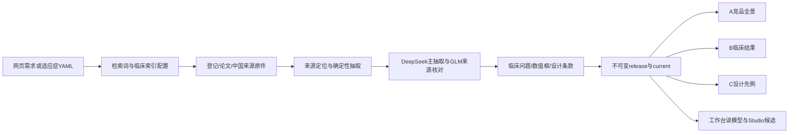
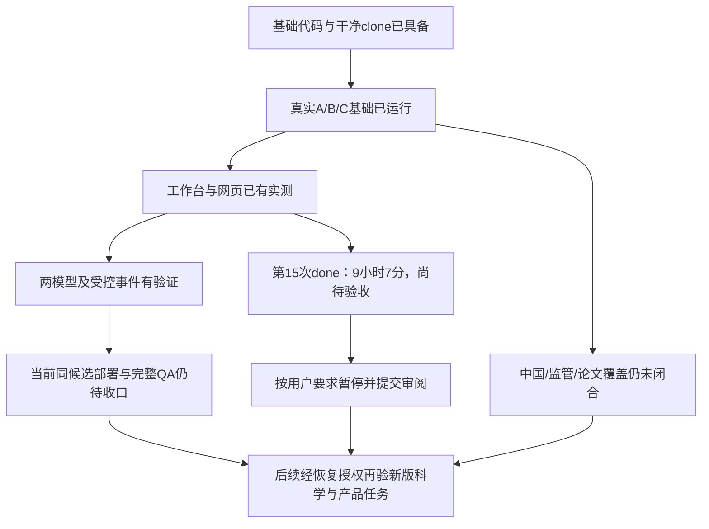

# ciw v2｜第15次重建后交接与全阶段复盘

> **PAUSED｜2026-10-31，第15次已结束并完成资料保全。新候选尚未独立验收，未整体交付。**
> 覆盖范围：2026-10-27接收新ciw执行包，至第15次重建终态。此前v1、1007V1及ciw2仅作背景，不恢复其范围。

## 1. 给外部审阅者的入口

当前两个审阅分支：

- [CI源码与全部当前记录](https://github.com/smkzw/competitive-intelligence-workflow/tree/codex/ciw-clinical-endpoint-index)。第15次使用产品提交`786bf8ecabdac7cae352a1004c6e0b878aafc853`、启动时HEAD`0e00486d44fcd1207fb94276d4e74d42eb1f8514`。
- [工作台CI接入增量](https://github.com/smkzw/protocol-v3-workbench/tree/codex/ciw-report-reading-focus)。运行产品提交`389fdea3b310b541366ea17de714e5fccf4d6758`，启动时文档HEAD`b102f7e0c15866115f2c7358bd42b665de355b7c`，最新暂停文档提交`5a2cdb85610b78104b5c5e7cc08f76102887651b`。
- CI较早发布分支`codex/ciw-v2-trunk`停在`ef7e846`；WB较早`feat/ciw-release-adapter`停在`36695f6`，不含全部本轮修复。默认main仍为旧工程`3087943`，不要在默认main审阅这次v2代码。
- `archive/v1`和`archive/ciw2`远端标签在本轮实查中仍未出现。历史文档写过归档/清理计划，不表示已执行；本轮未强推、清理Git历史或合入main。

建议顺序：[STATUS](../STATUS.md) → 本文 → [PRD](../PRD.md) → [DECISIONS](../DECISIONS.md) → [ARCHITECTURE](../ARCHITECTURE.md) → [PLAN](../PLAN.md) → [执行包](EXECUTION_PACK.md) → [审阅清单](REVIEW_INDEX_20261031.md)及[manifest](REBUILD15_REVIEW_MANIFEST_20261031.json)。审阅材料不构成恢复构建授权；当前暂停由用户解除后才继续模型调用/研究/新测试LOOP。

## 2. 来龙去脉与当前目标

早期项目是可安装的多Skill、三宿主、三类大型门户工程。多轮审阅后，用户选择了更精简的ciw主干：**医学经理工作台“证据调研与方案设计”的竞品事实底座**，首个项目CRSwNP/MG-K10。新主干起初来自附件，不能因GitHub main仍是旧工程就把v2推进覆盖到main。

用户给出的本阶段目标原文：

> 解除暂停，继续基于v2（ciw）新的、全面的、细节化的任务计划、任务执行规范、资料包（或文件指向链接）、PRD文档、Plan文档，以及分步骤的任务执行包、验收包等等，进行实际的、不间断地任务实现

持续要求：测试按根因成族、不每改一行跑全仓；实际用户测试由指定独立测试者进行，owner统筹修复；康哲Design功能优先、宽屏利用、紧凑可读；定期复盘和推送；无损暂停保留已保存成果。本次最新指令是“完成第15次重建后，无损暂停，记录执行包以来全部工作、未完成事项、踩坑和补充要求，推送GitHub供外部完整审阅”。

原生Goal API本轮实查为`null`。这不是没有任务目标；没有伪造创建、恢复、完成或暂停Goal对象。实际工作流暂停以进程终态、资料保全和本交接为准。

**现行产品合同**：自然语言网页或已核实YAML → 真实来源 → 确定性抽取/两角色核对 → 结构化release → A竞品全景、B临床结果、C设计先例三个独立中文HTML → 工作台读模型及Studio候选。默认先深入所选报告，其他类型复用资料补生成。

**不再属于v2**：PDF/PPT/Excel/CSV、门户事实编辑/撤销、离线分享、个人配置、定时监测、历史截止回放、手机、多宿主Skill安装、24门户矩阵、药智、排名/综合评分/Meta/NMA。这些有历史设计与代码不代表必须重新交付。

## 3. 系统组件及真正的数据流

|组件|职责及审阅重点|
|---|---|
|`cli.py / api.py / research.py / pipeline.py`|同一公开运行链；自然语言计划只是检索索引，不是科学事实；所选报告优先、复用已取资料、恢复及写者互斥。|
|`config.py / indications/*.yaml`|适应症名称、产品别名、概念与设计查询；人工配置优先，不向渲染层增加药名/公司字典。|
|`sources/ctgov.py`|完整分页获取登记；登记原文版本进入CAS，不按研究数量冒充覆盖闭合。|
|`sources/cde* / sources/nmpa* / sources/captures.py / document*`|Ego采集收件箱与解析；同许可观察版本保留，不把失败当零记录。|
|`sources/europepmc.py / pubmed.py`|论文查询及正式PubMed XML备援；失败/未查不改成无论文，完整分页和PMID集合有校验。|
|`extract/ctgov.py / models.py`|登记结构化原值/统计对象/人数/臂关系；新Intervention逐项原文、标签和精确Locator，不把源描述拼进另一字段。|
|`normalize/arms.py / products.py / semantics.py / design.py`|明确关系、时间/域/指标、原始设计字段及作用域；未知不猜，源内矛盾保留。|
|`verify/llm.py / transport.py / stream.py / crosscheck.py`|两家族来源核对、内容键缓存、一次定向纠错、真实身份/完成状态、SSE和有界故障处理。|
|`verify/endpoint_index.py / endpoint_families.py / comparison_axes.py`|来源指标索引→相关临床问题→可共轴数值框，分开处理；不是相同中文标签就共轴。|
|`verify/events.py / publications.py / attributes.py`|动作日期/产品/适应症/患者范围引文、论文组与估计对象、属性来源；不靠模型自信采用。|
|`verify/design_clauses.py / design_labels.py`|真实试验条款与中文阅读分别核对；原文/父条件/队列/时点不断链；背景检索命中不自动成为设计特征。|
|`analyze/* / render/*`|分析产生读模型；Jinja/原生JS/ECharts只投影。图、同查询表、来源与筛选保持同一集合。|
|`release.py / store.py`|CAS/SQLite/阶段与发布；不同字节不覆盖旧release，完整渲染后原子切current；正常数据库不回灌旧备份。|
|工作台`ciw_research* / ciw_release_adapter.py`|网页后台任务、身份/租户隔离、幂等、失败旧报告可读、版本绑定托管。|
|工作台`mw_core/design/ciw_release.py / competitors.py`|从结构化C行读取候选，绑定release，保留选择/评价流程，不读HTML作AI输入、不重跑药物分类。|

## 当前任务进度（验收层级，无虚构百分比）

## 4. 执行包以来做了什么

### 4.1 10月27日：新主干、来源、工作台、论文和PNH基础

- 从附件新ciw搭建独立环境；原包87测试是起点，不是当前测试总数。完成真实CRSwNP普通CLI release与audit40，建立隔离发布分支。
- CDE采集/解析、NMPA许可列表/详情及官网/公众号收件箱接通。CDE59份详情/75登记，NMPA后来补齐16份详情；不把站点国家误记成登记地域，也没找到就不造MG-K10 CRSwNP登记号。
- 工作台项目source-manifest曾503，按D13增加默认关闭、回环隔离本地开发身份；没有关闭正式身份校验。A/B/C托管、全宽阅读、Studio候选进入现有选择流程。
- 论文补充保留原文、真实分组、调整差值、CI/P/N与定位；源内臂关系矛盾不翻数组修原件。DUBHE按论文组呈现，无独立登记臂时留未绑定。
- PNH确实已有“仅配置变化”的基础CLI release、audit40和三页实屏。**未完成的是完整科学覆盖与当前独立用户泛化LOOP，不是PNH从未运行。**
- 将最初三家族机制按用户要求改成DeepSeek主抽取+CMS-SMK GLM核对；旧响应与状态只读兼容，不把历史仲裁改称新流程。

### 4.2 10月28日：网页自助、按需报告、索引与纵向密度

- 工作台增加适应症/研究问题/A/B/C输入、后台生成、历史任务、失败恢复和补生成。按身份与租户隔离，重复点击不多启动；HTTP断开不杀后台任务。
- 用户指出首份狼疮肾炎同时准备A/B/C耗时约3小时40分，D20改成所选报告深入优先；B/C不再等待A属性核对。补生成期间保留旧iframe与已提交报告。
- 临床索引来自真实标题与完整定义，修复组织学临床应答被“count/eosinophil”误排为PD、proportion强加百分号、Week1误卷入Week12等。
- C原终点定义、原入排、给药与治疗期、末次给药后窗口分开；明确列出原文阈值与上下文。
- 宿主与报告两层一起收紧：表单/研究问题默认收起，任务操作并栏、卡间约10px、16px数据字、嵌入复用导航。分类图按10/6/4行窗口取高并平移至全部数据，修复resize返小不恢复。
- CMS证书过期时按D21临时用DGX/glm，未关闭TLS或擅改共享路由；D22按用户恢复CMS-SMK。连接探测秒级不等于真实任务速度/临床接受。

### 4.3 10月29日：真实临床问题、共同数值框与来源恢复

- 临床主题相关与共轴资格分开，保留量表、分析集、基线、期别、时点、单位和原始N；不同定义在同问题下分面，不能单靠字符串相等或中文标签归并。
- CAD正向实屏：CADENZA第27周2.647/N19、1.125/N20与CARDINAL2.76/N22进入同一来源支持框，三条历时线195点，点表及来源保留。对应固定候选，不给所有适应症泛化盖章。
- EuropePMC真实503后，增加正式PubMed ESearch/EFetch XML备援；一次实际保存9份XML、识别2份合格摘要并新增1条结果。它不是用户要求的Hb应答或输血独立，未改名凑数。
- 保留基线class、源统计量、独立组值及有路径的多个来源分析；工作台不因缺少组间差而吞单组结果。
- 出现一次取消等待后重复启动导致约29分钟并发：加run/research/render单写锁与启动claim；锁文件存在不代表锁被占，不能删锁绕过。另修owner观察助手混入目录事件提前返回的问题，只认精确OS进程退出。
- 新资料不再重拆已经接受的整个临床目录，成功来源/批次保留；缺凭据前置拒绝，运行环境与模型在线状态分开。

### 4.4 10月30日：C中文及条件、事件与论文、实际图形

- C按主题形成全研究设计矩阵，中文阅读与科学原文分离；完整AND/OR、分支/父条件、例外、既往ICF时间方向保留。四研究C07切片22原子/24展示通过有限来源与两宽接受，不把其余82研究视为已完成。
- 公司/公众号旧事件曾有引文不能支持产品/适应症/动作、detail借篇内别句、计划冒充首例等真实问题。905861a/6ed41b3修复后，受控候选441来源/315缓存；固定20事件源审0错，真实待核3/30=10%，不是只用可见事件粉饰分母。
- 15论文原值/CI/P/N/quote保留，漏6条NCS补回问题和框架，7组间差保留。受控M4候选尚未切正式CRSwNP宿主current，不能写“用户已拿到新版”。
- C单项摘要卡322.6→172.6px，减少150px，不缩16px；86→1→86可逆。B独立点估计、CI、P及原文Esc局部实测；不以区间线代替点，不填装饰假点。
- 共享ResizeObserver与tooltip生命周期修复；真正tooltip在body，不按图卡内部查不到判失败；表格/图卡分别计数。
- 完整typed singleton JSON只在完整Schema通过时按1条解包；未知包装/半对象仍拒绝。真实原缓存重放与后续运行证明包装根因已越过，不能把下一个504说成包装修复无效。
- GLM非流式两次约600秒504，停止第三次相同盲试。5124d97同端点接SSE，不换模型/预算/提示/缓存键；只保存content及真实完成/usage，断流不缓存、不自动重发。

### 4.5 10月31日：SSE真实成功、版本页面、源/表示根因及第15次

- 真SSE38份成功答复，3次超过600秒、最长780.976秒；不再只是假后端测试。真实12原子length父批一次拆6+6，9条通过3待核，单原子不裁、子批不递归。
- 实际原网页先生成e60b，再第14次生成ec1b，123源/255缓存/427核对，86行、489摘录展示、304中文展示/294唯一采用，21唯一阅读待核（22展示）。原123来源/旧239缓存逐行保全。
- 混合疾病原始分节标签用精确原字段位置，保留全研究N12/N24，不伪造目标病种队列N；真实变更原件形成新源ID，不能编辑标题却复用旧不可变source_id。
- 修复稳定报告URL读到旧HTML：新路径绑定committed release ID，HTML与资源同版本；旧版本404而非混入新data，新旧路由private/no-store。部署自有单API时16份任务/current摘要不变。
- 第14次新9中文要点均经独立原文及最终B缓存绑定核对，24份CAS校验通过，audit40零错；旧285复用仅在所检完整投影/来源绑定一致范围，不能说又全文复审285条。
- 51条源问题按根因分为10规则误拒、39需原GLM纠错、1字段暴露缺口、1原源无剂量。10条用原最终B/同源证明重检；不把来源无剂量交给模型补造。
- 21阅读待核中19为表示误拒、2真实越界：英文计数、频次、并列日期、严格/含等比较、日历年、g/d原括号单位和纯eGFR式均成族修复。19个原B在一次影子重放中恢复，255缓存不变，294采用无新增误拒；两个越界仍拒绝。
- 三个独立代码挑战边缘（第一次/最近一次完整采集、显式至少1项、未写数字的每周频次）已成族修复，周/月与1/2次不混。
- 原始Intervention.description、armGroupLabels、精确Locator接通。NCT03170323两组药物剂量确实原来就有，系统漏读；同名多记录不合并、未知标签不造臂。新字段不进入纯入排任务：预计29既有任务材料变化、21保持，另5个真实叙述lookup需核对，非代码hash清缓存。
- 背景检索命中不自动成为结构化试验特征；原背景仍在研究叙述，明确本研究安排才入条款；孤立Inclusion/Exclusion标题不成临床要点。两条真实越界的纠错反馈指明只翻译原字段、context不得借值，仍走同一GLM一次纠错。
- 最终903测试13.99秒/Ruff/diff；隔离158d13b五批精确合入主作者786bf8e，源/测试/配置字节相同，没有为合入再重复整仓测试。代码与记录都已推当前开发分支。
- 第15次由原Cursor从网页“重建当前报告”一次启动：2026-10-31 04:07:54.682276 UTC。156CI/5WB源码pin、123源/255缓存逐行与315原子前检通过；Task85消失按永久授权替代87/Profile2并回总览保持控制。第15次真实结果见第7节。

## 5. 用户在期间新增/调整的要求

|裁决/要求|当前做法与边界|
|---|---|
|D13 本地开发身份|默认关闭、仅回环与隔离项目；不是正式宿主认证。|
|D14 DGX接入授权|从授权workbench凭据/环境或key文件读取；不读owner/application key、不改服务器，不入Git。|
|D15 分支发布|新ciw独立分支保留main；没有执行旧历史强推方案。|
|D16 Studio|把current的C行作为候选，保留原选择/评价流程；不是新建第二套Studio。|
|D17 两角色|DeepSeek主抽取、CMS-SMK GLM核对，取消Qwen/第三模型仲裁；不是盲审。|
|D18 论文组|按论文明确分组关联登记研究；无独立登记臂保持未绑定，不能拦掉真实结果或猜绑。|
|D19 网页自助与双QA|补齐网页新建/检索/生成；Luna与Cursor从用户视角操作，owner统筹修复。|
|D20 所选优先|优先深入所选报告，其他类型按需复用；不再每次A/B/C全套等待。|
|D21→D22|CMS TLS失败后用户临时指定DGX/glm；用户确认恢复后切回cms-smk，不擅自长期保留fallback。|
|康哲Design|功能为主、美学为辅，宽屏充分利用、中文/按钮/配色/层级；不是机械套皮。|
|纵向密度|首屏有效信息增加，不靠缩字、裁事实、空大图或重复导航撑页。|
|真正横比|ECharts+同查询表；历时折线及标注。数字罗列、一研究一卡或链接列表不算。|
|专家读者|主层删除成片“边界/限制/不等于”教学，科学约束在模型/数据/分面中落实。|
|试验身份与原文|药物/适应症/期别/可信公司角色先行，NCT辅助；原入排折叠可查，阈值字重/深红下划线。|
|Ego长期授权|专用空间缺失可创建替代/恢复窗口，不再问；不动日常登录、不清缓存、不升级，不finish/handOff。滑块仍由用户完成。|
|长等候|120分钟窗内主线程静默，仅OS退出事件；不看进度、不因慢重派/强杀，不改在途消费代码。|
|开发节奏|成族RED→完整最小改动→相关批，里程碑宽门；禁逐标签三路整页循环、代码hash缓存失效和新平台。|
|本次暂停|第15次自然终态后暂停，完整记录与GitHub交接，给不在本机的审阅者；不启动16。|

若旧Skill、旧审阅、原执行包局部条款与这些冲突，后来的用户裁决和当前PRD/DECISIONS优先。不重新询问已裁决事项。

## 6. 模型、测试者及证据分层

|用途|请求/现行路线|实际可证明什么|
|---|---|---|
|产品主抽取|DGX/deepseek|观察DeepSeek-V4.1-Flash-1017；本轮C临床请求effort未设置；A属性已有单独低思考试验，不扩大到临床核对或声称性能收益。|
|产品核对|cms-smk/glm-5.3-flash|SSE真实完成；临床原文+候选核对、补漏，不是盲抽取。65536输出/7200秒不因本批改变。|
|历史临时核对|DGX/glm|D21实际GLM-5.3-Flash-EXL3回执保留，不改标成CMS。|
|独立测试/审阅|Pi/openai-codex/gpt-6-luna|max/priority请求与同名模型记录；明确范围的科学/代码/浏览器结果，不是医学正式签发。|
|独立用户操作|Pi/cursor/default|实际底层模型/effort未暴露；不猜测。真实网页生成、筛选、返回和来源操作由其完成。|
|owner|当前Codex|代码与最终整合、实际图片检查；没有代做本轮真实网页生成或新来源模型调用。|

产品采用只有确定性规则和crosscheck两种。外部QA是用户明确要求的软件/来源测试，不向产品增加第三仲裁模型、资格签发或逐观察审批。

测试通过≠模型运行通过≠临床来源正确≠浏览器可用≠正式部署；所有PASS绑定具体代码、来源、release和运行范围。15生成完成也不能把14的科学/实屏证明拼成15完整接受。

## 7. 第15次实际终态与保全

第15次在 **2026-10-31 04:07:54→13:15:13 UTC（北京时间12:07:54→21:15:13）** 正常 `done`，耗时 **9小时7分19秒**。原Cursor从正常网页仅启动一次；OS观察器收到Python及UV两进程退出，写锁可独占获取。没有第16次、未强杀/重启健康运行。现已按用户要求 **PAUSED**，仅整理、保全和推送记录。

|项目|第14次基线|第15次终态|
|---|---:|---:|
|当前release|`rel_ec1b5ff8c4ada9d8`|`rel_fa2407ca44d9c4a2`|
|来源/模型缓存/核对记录|123 / 255 / 427|123 / 438 / 596|
|C研究行|86|86|
|摘录展示项|489|351|
|带中文阅读的展示项|304|334|
|唯一采用中文原子ID|294|322|
|当前需中文处理的唯一原子|315|332|
|来源分节标签展示|6|4|
|源条款待核队列项|51|47|
|中文阅读待核队列项|22|11|

当前332原子中10个唯一ID无已采用中文投影；11是队列项数，两者不混用。新增88原子ID、退出71旧原子ID；旧294采用中230个ID仍采用、64个ID不再位于采用集合，新采用92个ID。来源条款改组、上下文及背景剔除会改变派生身份；本次未逐项独立审定这些变化，不能把数字变小自动写成去冗余成功，也不能仅凭ID退出就判原始来源丢失。**下一次先对这组变化作原文对照，不重新生成。**

待核还包括25个B索引未执行、3个臂关系冲突。核对库596行含487 verified、101 needs_review及8历史failed；历史累计状态不是当前队列分母，不将旧失败当成15新失败，也不把done当科学完整。

本次新增保存183份真实答复：DeepSeek63、GLM120。DeepSeek答复元数据累计16005.184秒，GLM16821.862秒，合计约9小时7分；这不是额外时长，不能再叠加准入等待。DeepSeek最长1446.107秒，GLM最长816.125秒；9份DeepSeek答复含429准入重试，记录等待共2005秒，已经包含在elapsed中。两家请求effort均未设置；DeepSeek报告578617推理token，GLM字段报告0不证明服务内部没有推理。缓存新增答复数不等于所有HTTP尝试数，限流/未缓存错误不在这个分母。

已静态确认的放大路径：`verify/design_labels.py::_reading_batches`只在整批全部accepted时跳过；部分待核时把最多12条整批再次交给A/B，`_readings`收到后又跳过已接受兄弟。两段“原文条款→中文要点”各自核对，加上全上下文内容键变化、批次身份变化和定向纠错，共同放大调用。用户在约4小时46分和8小时分别追问；第一次仅报存活/更新不足以解释停滞，第二次才拆出真实调用成本。**增量重建效率与可信进度反馈是首要未完成项**，尚未修复，不承诺当前实现可零重复调用恢复。

保全：123份CAS逐文件SHA匹配；原123来源行、旧255缓存行逐行SHA不变；旧ec1b release、after14备份保持。71结果、7安全概要、120产品及123试验基础字段前后规范摘要相同，试验仅比较时排除本次新增原始interventions字段。156份CI消费源码/测试/配置及5份WB消费资产全程最终pin一致。

第15次release SHA：`161bf82667ceda056aab898c239471cdc652e16671fccace0ff979503162fa60`；current SHA：`94b0d4915e6f92e5bb59c0d885c25211941e61023dfe6f3a4e752a9700bd6b29`。一致性SQLite备份5206016字节，quick_check=ok，SHA：`12b6495b000efa095c78f2218b83feddeb09c0fdb5c7f980135accb51d761902`；原库未回灌。release.code_version仍为版本字符串2.0.0a1，不把它当Git身份；具体源码见manifest。

**15新候选独立科学审阅、audit及浏览器实屏均NOT_RUN**。仅做终态/文件/数据库保全与计数；14的四宽/来源结论不继承到15。当前只生成C，A/B同候选实际消费、Studio医学AI、正式部署没有因此接受。

启动前基线：ec1b，releaseSHA`d04399158e26995ca7609af47b84b99731316dcbc4640a9947b46835e99a1a3d`，currentSHA`74f33c7a80c66bd8fe7744f2c83d66da4076421e557ddf8bcd665ba6c56c74a2`；123来源/255缓存/427核对。after14只读一致备份SHA`0087e6e03466620f97390b9705a78d452c6ce4f9b8dc0c23e1568251a1b444ae`。

前四个7200秒OS窗口到期均仍pending，第五窗收到双退出事件。窗口内按用户要求静默等待；在窗边核对终态/身份，并应两次用户追问作有界状态和元数据诊断，未固定轮询模型进度、未读取完整模型正文、未重派或重启。不能声称整个等待期间完全未读状态/缓存。

暂停之后：不新建调研、不重建、不开16、不调用模型、不清CAS/缓存/数据库/原生会话。阅读服务保留不等于后台还在生成。Ego仍保留专用空间与Agent控制。

## 8. 已经证实与没有证实

|证据|已经真实做到|不能借此宣称|
|---|---|---|
|CI开发门|隔离903passed13.99s，GitHub干净clone903passed15.97s/Ruff/diff；主作者与隔离源码/测试一致|远端另一台机器已执行903、全部临床和上线条件通过。|
|WB代码合同|版本路由等63相关；历史reader组件/构建及Studio选择实测|全工作台测试、正式身份、真实Studio医学AI已接受。|
|CAD正向横比|固定候选的3组/2研究、195历时点、查询与来源|任何相似名称都可同轴、全部适应症泛化已通过。|
|受控M4|固定20事件0错、待核3/30=10%；15论文保真、6漏项可达|正式CRSwNP宿主已切至受验候选、监管/论文宇宙已完整。|
|ec1b C|四宽1440/1600/1920/2560无页面溢出、报告16px、86→1→86、Esc、5资源一致|15新数据视觉/科学全面接受；所有A/B物理页/嵌套详情都已验。|
|新9阅读|逐源/最终B缓存绑定，24CAS核验；audit40零错|复查了全部285旧段落、audit能判定所有C临床语义。|
|19表示恢复|19原B影子重放、294旧采用无新误拒，2真越界仍拒，255cache不变|手工修改实际账本、19一定全部进入15（须看15实际结果）。|
|length二分|实际12→6+6，9通过3待核|部分子批零新调用续接已独立真实接受。|

## 9. 踩过的坑与根因复盘

|问题|真实根因与影响|处置/剩余问题|
|---|---|---|
|模型在线却401|持久Eval缺凭据与原生Bash环境不同，历史15个401又混进当前汇总|公共入口缺key前置失败；已见两路线新成功答复，不再把401说成DeepSeek离线。|
|TLS与超时混淆|三个鉴权共享同一过期CMS上游；后续另有非流式约600秒504|用户指派临时DGX后切回；不关闭TLS。SSE已真实越过600秒，非增大本地timeout的功劳。|
|取消等待误当退出|测试者重复启动导致重叠写入，owner事件助手也混目录事件|run/research/render互斥+claim，OS精确双退出；旧不可信派生候选不作为接受。|
|源里就有矛盾|CROWNS2干预关系相反、GPP Placebo原type实验组|原值保留/明确冲突，论文独立组、未知角色；不翻数组或猜成对照。|
|引文包含数字却含义错|借篇内别句、患者先行词截断、计划当动作、来源统计被扔|片段/动作/人群与方向分别绑定；20事件源审而非只看audit计数。|
|看起来没有结果|索引把组织学应答归PD、基线/独立组值/论文NCS漏展现|修共享抽取/索引/读模型，不在页面补字典或造零。|
|单研究小图“完成横比”|字面定义严格分桶导致临床问题碎成317个单研究问题|主题/数值框分层，CAD有正向例；泛化仍未闭合，不按问题数量报功。|
|旧HTML配新data|稳定URL与旧浏览器缓存/服务字节不同|release版本路径、no-store、过期404，实际5资源hash；不用清缓存代替修产品。|
|截图/探针假缺陷|动画未完成、hidden子rect不等于paint、bodytooltip不在图卡、旧getOption缓存、计全页tbody|实际绘制/可见性与同查询集合核验；历史错误探针保留作INVALID，不涂PASS。|
|17点误报|只数首个ECharts series|八组共85，unknownN的第86研究仍可达；没有据此误修图形。|
|规则误拒中文|英文计数/并列时点/词汇比较符/公式必须汉字等|按19同族及正负反例修复；2真越界仍拒，非全放宽。|
|真实资料漏读|只读arm.description，未读intervention.description|逐项Locator接通，不借组数组顺序。避免无关新增材料使纯入排任务重核，但混合任务仍有成本。|
|旧审阅意见自身不适用|陈旧c.js pin；未归一化运行配置选错task；历史空B不属当前task；编辑标题却留旧不可变源ID|用当前字节/真实任务/源版本关闭误报；不复制旧报告造事实，原审阅保留。|
|执行节点越界checkout|曾撤回owner两处504提示，违反保全规则|从已知完整补丁恢复并验证，没有原件/数据库/用户工作损失；不能把worker自报当独立接受。|
|记录/命令也会出错|不存在测试路径、unittest跑pytest为0、Ruff首轮失败、观察器launch整数schema、私有诊断输出名未替换|保留真实NOT_RUN/FAIL，改正确方法；19诊断曾误覆盖2条诊断后已分开重建，源/DB/正式报告不变。|
|跨根路径风险|默认cwd是旧中文工程；CONTROL与作者树同名相对路径曾读错而报不存在|所有可变操作显式英文根；恢复材料用绝对私有定位，公开只用仓库相对路径。不触旧中文工程。|

本次用户两次追问后，20:08只读诊断显示已运行8小时，新增161份已保存答复（DeepSeek55、GLM106）；对应记录累计耗时约3小时39分和4小时21分。中文阅读批处理只有整包全部接受才跳过；有待核项时重新抽取/核对整包，随后又丢弃已接受兄弟条目的重复结果，是已经静态确认的调用放大点。该现状和耗时反馈不到位均需记录。并发准入等待已可能包含在请求elapsed中，不能再次相加；该中途截面不是最终总量，也不是完成声明。

最重要的复盘：工程质量的主要差距是**语义组织与源上下文、真正用户任务、运行成本和证据范围**，不是再增加图表数量或再套一层审阅平台。模型成功、数字保真与科学可读必须分开证明。

需求变化与实现缺陷应分开：网页自助和所选报告优先是用户明确增加/调整的工作；初版报告可读性、组别/来源语义、错误判定和恢复纪律没有做好，不能归咎于用户增加要求。源条款整理后再单独整理中文，可能让同一原文经历两组模型请求；组合任务又带入整个上下文，少量新字段会改变整组材料键。本轮收窄了无关干预输入，但尚未证明耗时问题已解决。值得审阅者评估是否能在现有两角色与原模型内合并来源条款和中文投影的核对、细化有证据的缓存单元；不在本次暂停前实施，也不新增平台。

确定性数值多重集一致仍不能证明“某个值属于哪个指标/条件”完全正确；比如两个条件各有不同年数，单看集合不能证明没有交换。当前仍依赖来源字段/作用域、GLM原文核对及有范围的独立科学审阅，不能把正则或测试数称为通用医学语义证明。

## 10. 尚未完成与建议优先次序

1. 优先审第15次已有新报告的独立科学/中文/产品视觉；对47源条款/11阅读队列及88新增/71退出原子作来源差异对照。原39条源B纠错和2条越界的逐身份关闭尚未完成，不靠总数降低代替关闭，不盲启16。
2. C不以长背景段充当入排特征；同一完整父条件在多主题单元格重复的问题仍可优化为共享条件层+原位来源，不牺牲AND/OR。图形应服务设计问题，不能靠“其他终点”大类或元数据图撑版面。
3. A品牌/联合制剂/创新属性、企业/MAH/监管来源与全竞品覆盖；未知不填假信息。MG-K10 CRSwNP登记尚未得到来源确认，新适应症中国来源未闭合。
4. 受控M4到正式CRSwNP宿主的可恢复数据切换；关键II/III期论文、其它合格摘要、源内关系冲突与缺口收口。
5. PNH有基础端到端，GPP/CAD/EoE/MN有不同层级实测；指定双测试者更换适应症/提示词/报告类型的完整测试—修复—再测LOOP仍未完成。
6. 正式宿主身份部署、当前版本工作台全消费与真正Studio医学AI仍未接受。此前Studio选择/详情实测不冒充AI推荐质量。
7. P2：无关前置否定过严拦真实首例、真实nested键盘场景、其它页面/尺寸覆盖。源代码仍有`pipeline._run`89行、`analyze.results._longitudinal`84行超PLAN80行；无Python源文件超600行。不要为行数把医学逻辑压成一行。
8. 时延仍是产品问题：首报告/原文整理/核对可能很久。应按实际回执区分模型推理、队列、纠错和上下文重用，优先减少无关材料重核及重复完整条件；不先降模型、降证据标准或新建调度平台。

这些是有依据的后续建议，不是本次暂停前继续实施或新增一套权威计划的授权。

## 11. 无损恢复：先读取成果，不重做已经成功的工作

仅用户解除暂停后：

1. 读STATUS/本文/manifest，定位两个真实英文作者树，核HEAD增量，保护无关文件；不要默认cwd、旧中文工程、reset/checkout/clean或全量add。主分支/旧标签不擅改。
2. 同机按私有恢复索引找到工作区，核来源/缓存/当前指针和一致性备份；健康库不回灌。跨机clone只恢复代码，不恢复私有原件/模型缓存/运行记录；不能假设本机路径存在。
3. 第15次已提交fa2407，先审该版本，不再生成；优先修复中文部分批次重复处理及用户可见进度，再考虑需要新模型请求的有界续接。当前资料完整保留，但现有实现还不能保证部分批次零重复调用。旧ec1b保留作差异基线，不回灌健康库，不重查所有登记、论文或已验事件。
4. 采用本次冻结版本、当前规则与实际原件，独立挑战新增/改变事实；相同完整科学材料/中文投影才复用旧接受。不要再通读全部旧日志或等待已退出PID。
5. 如确需新实际生成，仍由用户指定Pi测试者正常网页一次动作，捕获实际attempt和父/子身份，离开详情保持Agent控制，owner仅OS等终态；工具等待取消不授权重启，长运行不改消费代码。
6. 一组根因反例→完整最小修复→相关回归，里程碑一次宽门；旧失败不改标，未运行写NOT_RUN，不追加签发/逐事实审批/图数据库/本体平台。
7. 新报告科学与视觉实际通过后，再安排不同适应症/问题/报告LOOP及其它里程碑；不以903测试、一次audit或已生成文件宣布上线。

## 12. 远程审阅资料、资源与不包含的内容

GitHub提供：全部当前源代码/小夹具/规范、历次暂停复盘、当前详细handoff、脱敏manifest、提交索引与执行包允许的小型实屏。已在剥离模型凭据的临时GitHub干净clone核验启动代码0e00486：uv sync --frozen --offline、903测试15.97秒、Ruff与diff均通过；临时副本已自行清除，不碰运行资料。此为同机新clone，不称远端机器实跑。没有删除历史FAIL或覆盖旧检查点。工作台相应代码单独在其当前分支。

不入Git：CAS第三方原件、完整模型答复、SQLite/阶段/运行日志、凭据/cookie/token、机器绝对路径、内部Design原件。远端可以审源代码与离线测试/截图，**仅clone不能复原私有运行，也不能因此宣称已独立复现科学验收**。manifest提供版本、摘要和公开来源定位；若未来换执行机，需要经授权转交私有运行区，凭据另从环境注入。

资料整理仅做过：退役隔离环境的忽略缓存经无占用核验后清理；6份完成私有stdout无损gzip约33.8→12.0MB，解压原SHA一致；逻辑字节不冒充物理磁盘节省。原件、模型缓存、失败快照、恢复库和原生Agent会话不清理。本次15运行期间未为省空间触碰活跃资料。

## 13. 历史记录索引（原文保留）

- [10月27日首次交接](PAUSE_2026-10-27.md)：169测试、基础来源/PNH/论文、早期三模型及中断现场；三模型条款后来被D17替代。
- [10月28日D22/密度交接](PAUSE_20261028_D22.md)：网页按需、CMS切换、GPP新副本与密度实际范围。
- [10月29日交接](PAUSE_20261029.md)：共同数值轴、PubMed、401/并发与恢复。
- [10月30日首次交接](PAUSE_20261030.md)：四研究C07、事件真实失败、草稿补丁，不等于当前缺陷仍完全未修。
- [10月30日SSE前交接](PAUSE_20261030_AFTER_SSE.md)：20事件受控通过、论文漏展现修复、attempt8–11故障和SSE当时未运行。后来的真实SSE已运行，不能沿旧文重跑。
- [阅读密度记录](../FRONTEND_DENSITY_20261028.md)、[截图索引](../screenshots/README.md)：每张对应版本和范围；不是同一候选全通过。

当前暂停点以本文和STATUS为准；这些历史链接解释经过，不重新激活旧执行命令。
