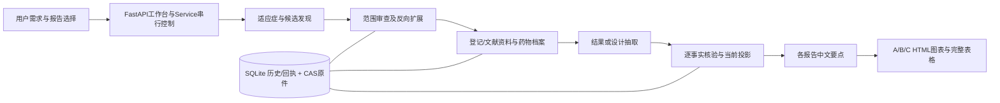

# rebaseline-v2 无损暂停与审阅交接｜2026-10-26

**当前状态：用户要求暂停；宿主 Goal 实查 paused；本轮拥有的研究进程已安全退出。M1–M6尚未全部交付，非RC。**

唯一当前状态是 [STATUS](STATUS.md)，产品权威仍是 [PRD](01_PRD.md)、[架构](02_ARCHITECTURE.md)、[计划](03_PLAN.md)、[开发规则](04_AGENT_RULES.md)。本文件是版本绑定的交接和复盘，不建立第二套产品权威，也不授权恢复研究。

交接前已推基线：`99ad7bfe3e0541dd48c15d616c49d87179434ba1`；产品代码批：`b6a11a487987dbac621fdd02738f05dd4c05157a`。分支 `codex/rebaseline-v2-m1`，仓库 `smkzw/competitive-intelligence-workflow`。本文件及同批状态记录由紧随基线的暂停提交绑定；以该提交实际SHA和远端核验为准，不在正文内制造自引用提交摘要。

## 1. 审阅者先读什么

1. 本文第2–5节，明确项目已经重基线，避免恢复旧计划或重复已完成工作。
2. [PRD](01_PRD.md)、[架构](02_ARCHITECTURE.md)、[计划](03_PLAN.md)、[规则](04_AGENT_RULES.md)；验收定义分布于PRD及计划各M条目，没有新增平行验收标准。
3. [本次暂停机器回执](evidence/20261026-lossless-pause-review.json)：终态、备份摘要、来源、运行时、测试与未完成项。
4. [检索依赖与恢复证据](evidence/20261026-search-dependency-and-recovery.json)、[分类与限流证据](evidence/20261026-profile-taxonomy-and-backpressure.json)、[Cendakimab定点原研证据](evidence/20261026-cendakimab-reference-source.json)。这些只证明各自范围。
5. 根任务 [.trellis M1实施记录](../../.trellis/tasks/10-23-rebaseline-v2-m1/implement.md) 的198–212段及 [M2实施记录](../../.trellis/tasks/10-25-ciw2-m2-independent-reference/implement.md)。不用从根HANDOFF全部历史重读或等待旧PID。
6. 用户另要求上传已有测试报告：[三份报告下载与范围](sample-reports/20261026/README.md)、[报告ZIP](sample-reports/20261026/ciw2-test-reports.zip)、[逐文件manifest](sample-reports/20261026/manifest.json)。原字节保留，不是当前完整C或同一候选验收。
7. 需要复核真实数据和模型过程时，再使用第10节受控本地资料。GitHub不包含数据库、第三方完整文档、CAS或完整模型日志；仅克隆仓库不足以复现本地长程研究。

本轮选择“直接保全与记录”：用户已要求停止，安全退出、SQLite快照、文件校验和记录整理均可由工具验证，不再派发执行或会商节点。既有独立意见如实保留；暂停期间没有新模型研究、临床来源请求、浏览器操作、清理或产品改动。为用户要求的报告上传，只额外取得ECharts官方LICENSE/NOTICE，未获取新的临床资料。

## 2. 来龙去脉：当前构建的究竟是什么

### 2.1 历史方向及用户反复纠正的问题

早期项目以多宿主可安装Skill套件、三独立门户为方向，经过0922、0923、0924及1007等专家审阅包逐轮纠偏。暴露的问题包括：流程跑通被误当完整交付；来源只到报告级而未到事实级；临床语义/组别/分母错误；英文与NCT主导的字段墙；极稀疏图卡和满屏重复数字；过多防御性说明；恢复时无关依赖变化造成重复研究；只留统计而没有可恢复数据。

用户随后明确：报告是给资深临床专家使用，首屏优先中文临床身份与要点，横比必须使用合适的ECharts图和完整表格，历时数据用折线与标注；不能以“全量可达”或孤立数字卡替代真正比较。不能用缩小字体、隐藏事实、空图或机械设计规范换取美观。

用户提交 `rebaseline-v2` 后，产品转为医学经理工作台中的**单用户独立Web子系统**，由平台内嵌最小Skill Harness执行研究；不再把外部Agent宿主作为产品运行基础。v1保留为历史和有选择的证据，不是当前发布合同。

### 2.2 当前v2合同与旧范围的区别

|内容|当前v2|
|---|---|
|运行形态|Python单用户Web、串行队列、SQLite与内容寻址存储、内嵌9个Skill|
|A/B/C|独立竞争格局、疗效安全性、设计先例；共同身份/事实/来源投影|
|中国与全球|中国竞品宇宙全面；全球尽可能充分；失败路线真实留痕，已有资料仍可用|
|验收|按M1–M6；M2三个独立参照召回≥95%；M4抽50条critical准确率≥98%；完整报告实际视觉和恢复等分开验|
|前端|HTML；桌面1440/1600/1920/2560；Kangzhe Design7.1功能优先；不恢复手机开发|
|明确不做|报告内编辑/同步/撤销、配置界面、离线分享包、PDF/PPTX、多用户权限、商业数据库|
|不是当前v2发布门|v1三宿主、24门户、旧编辑/分享链；不能拿旧通过结果给v2背书，也不能恢复它们阻塞v2|
|历史截止日|M5尚未完成，当前入口明确拒绝未支持的历史请求；不能仅把日期放标题|

若审阅者建议改变上述范围，应明确标为建议和影响，不能从旧包悄然恢复。当前Goal措辞较宽，具体范围仍由v2权威文档约束。

### 2.3 当前Goal原文及暂停依据

> 基于rebaseline-v2 新的、全面的、细节化的任务计划、任务执行规范、资料包（或文件指向链接）、PRD文档、Plan文档，以及分步骤的任务执行包、验收包等等，进行实际的、不间断地任务实现，直至完全交付。 注意对过度设计、构建过程（而非构建完成后）的测试要进行约束，避免出现“改了1处测试1次”的情况

最新用户指令是“无损暂停，做好任务记录，进行最新的github推送，撰写详尽handoff文档，我会让审阅者进行详细审阅”。Goal工具实际返回paused；没有标为complete。暂停后只处理保全和交接，审阅意见本身不自动恢复执行授权。

## 3. 持续有效的用户裁决

- 中国优先全面，不用Top-N、固定药物数或少量明星产品代替宇宙完整性。B保留全部相关研究，相关性与数值共轴资格分开，异质数据不硬并。
- 临床身份主显药物/方案、适应症、期别与有来源的公司角色；NCT/CTR保留但居次。正式中文药名优先，无核实名称不硬译，不能将申办方、代理、生产商当中国MAH。
- MAH法律实体与集团关系分别有来源和日期；未上市不造中国MAH，不从公司名猜集团，不扩renderer专用字典。
- 入排原文完整保留；提取评分/检验阈值并在原条款中以字重、下划线、深红突出阈值、否定和逻辑。不能以裸阈值替代条件、队列或访视。
- 默认阅读不铺“边界/限制/不等于”等防御性内容，不堆工程字段和英文墙。科学守卫、未解数据及来源放在正确层级，不能通过删原文或补0满足简洁。
- A分子类型与机制类别分开展示、筛选、分组和核源；抗体/小分子与C5/Factor D抑制机制不是同一字段。
- 创新药及有独立临床开发的改良剂型计核心；生物类似药单列、不进核心召回分母。正向产品证据与中国适应症资格分别核实，医院申办不自动排除创新药。
- 大陆、香港、澳门、台湾分别保留站点标记；站点标签不代替正式中国开发资格。country/city冲突不能当大陆已核。
- M2参照清单由独立Agent按权威来源建立、owner核源封存，再验召回；不要求用户或同事提供测试清单或人工验收。
- 已发表论文保留有效结果；动态状态每次调研核查。相同字节解析复用和本次实际网络核查分开记录。
- 历史报告只用当时已公开的具体事实版本，核发表/更正记录。当前真实可下载但首次公开日未知的方案/SAP可用于当前报告，不能倒证更早日期。
- 模型顺序 `cms-router/glm-5.3-flash → DGX/deepseek → DGX/qwen`；请求路由、实际返回模型及未暴露身份必须分开，不静默替换。
- Ego专用空间消失可自行替换，必要时恢复专用窗口，已长期授权，不重复询问；不改日常登录、缓存、profile或升级浏览器。
- 测试按根因成族集中运行，稳定候选再宽门；不每改一行全仓重跑，不反复派三路全页审查。
- 无损暂停保留已完成资料、未完单元、原始失败与恢复边界；不reset/checkout/clean、不无差别提交。当前没有触碰旧中文工程，也没有执行清理。

## 4. 系统地图：代码、Skill和数据各负责什么



|生产位置（Python路径相对src/ciw2）|职责与关键含义|
|---|---|
|`web/app.py`、`service.py`|表单/API、串行运行、重复启动、停止/继续；不承担科学身份推断|
|`pipeline/runner.py`、`stages.py`|按报告裁剪阶段、非阻断来源错误继续、最终状态与恢复；局部可用不冒充整次成功|
|`pipeline/stage_versions.py`、`stage_dependencies.py`、`tool_versions.py`|实际代码/Skill/schema/模型/来源依赖；失效应只影响对应工作，不可用手工成功标记绕过|
|`pipeline/expansion.py`|别名/靶点/企业反向扩展，逐query留来源和解释回执，最多三轮；未知保留|
|`pipeline/recovery.py`及抽取/范围相关模块|同run完成单元缓存、原任务/读集/来源版本核对；旧键不改签为新键|
|`harness/agent.py`、`llm.py`、`fallback.py`、`tools.py`|白名单工具、结构化submit_result、步数预算、模型路由、错误和用量；长载荷另入CAS|
|`skills/*/SKILL.md`|唯一作者源：intake、universe-china、universe-global、coverage-review、extract-results、extract-design、analysis-a/b/c；enrich复用extract-results模式，无第十Skill|
|`sources/*`|CT.gov、PubMed/PMC、FDA、搜索/微信插件、中国登记/CDE/NMPA及公开浏览器桥；PDF原件和layout文本、解析器身份、页码分别保留|
|`store/db.py`、`cas.py`|项目/运行/阶段/实体/关系/事实/来源/核验历史；不可变来源表示与当前事实投影|
|`domain/*`、`verify/*`|身份、临床语义、critical分级、引用/数值/上下文检查；原verified标签不自我认证当前规则|
|`render/portal.py`及design/results/drug_profile等|共享身份和来源，A/B/C各自任务投影；同查询图表/表格，不从发现attrs认证科学事实|
|模板/静态资产、ECharts|中文阅读、筛选/分面、图点定位、来源展开、Esc回焦；真实截图和键盘核验独立于Python测试|
|`store/backup.py`、构建hook、CLI|DB+被来源引用CAS标准备份，wheel/sdist内嵌9Skills；标准备份不包含HTML或大段Agent事件CAS|

事实与来源、来源首次入库时间与本次网络核查、当前裁决与历史状态都不同。`sources`保留raw/text digest及parser；`agent_steps`记录核查/调用/缓存。被外置的 `agent_step_payload` 必须额外保全，否则只有标准源备份不能完整回放模型材料。

## 5. 目前进展：完成了什么，哪些仍没有完成

|里程碑|已实现或有实际证据的部分|未完成的交付条件|
|---|---|---|
|M1 完整C|普通Service真实续接；已完成发现/范围前置未重跑；完整数据保全；当前139设计行|11来源单元未完；富集被用户暂停；设计当前抽取、verify、analysis_C、render尚待；没有当前正式完整HTML及科学/四宽接受|
|M2 中国宇宙|中国列表/详情、CDE部分路线、范围/类别组件；独立AD127/IgAN57/PNH28草稿；209精确原研来源链|三清单仍provisional，唯一核心分母与中国疾病资格未封存；210待owner审阅，211只原件；≥95%未测|
|M3 A与共同身份|正式名称/NMPA部分证书、公司角色/身份来源；分子/机制双轴；200四宽组件|三个完整真实A、全候选名称/靶点/阶段/MAH集团；A真实正向阶段图未验|
|M4 B结果|CT.gov多域和阈值/组别修复；17来源切片3010结果/1571安全；193b真实四宽20状态|完整论文逐事实、跨研究临床语义与全B接受；critical50≥98%未验|
|M5 全球/历史|当前来源版本/更正与公开日期规则、历史入口拒绝守卫|全球覆盖扩展、事实历史资格筛选、真实更新全链；不能解除守卫伪交付|
|M6 包装与加固|旧195/196候选离线安装、26资产/9Skills/CLI/静态渲染；已有组件恢复|207及后最终安装包、完整普通恢复/队列控制、使用量及M1–M5最终接受|

没有用测试数量、数据库verified计数、设计行数或来源总量替代完成判定。当前139行也不是139条经独立医学验收的完整先例。

## 6. 本阶段203–211的实际工作与修复

### 6.1 为什么普通恢复一度停在原地

1. CT.gov整文件摘要把AE解析变更传播到未使用它的search/get及宇宙发现，导致不必要重跑。203改为绑定已知可达助手/常量/别名/嵌套代码，动态全局/本模块类回退保守绑定，HTTP及身份策略仍显式绑定；expansion每query继续绑定真实工具合同。
2. 不能直接把旧阶段改成功。实际冻结134中重算七个已完成阶段与原历史一致，再在197副本追加三条**明确非新执行**的来源等价资格。原输出、原key及六发现前置不改；40旧抽取单位不能批量认证当前版本。
3. 独立审阅发现 `_PHASE` 的字串元组键字典未进入常量摘要，以及资格检查对expansion组件差异放行过宽。owner新增根因RED，沿用现有类型化字面表示补键/值绑定；用实际旧常量反算完整旧摘要，仅允许证明过的差异。
4. owner另发现后置检查在事务外，拒绝相邻阶段异常后可能残留三条资格；移入同事务，负向用例验证拒绝即完整回滚。
5. 资格程序是本任务定点操作 `203/prepare_candidate_v3.py`，不是新平台或生产自动迁移器。它的 `__main__` 仍属于历史提案入口，不应盲跑；真正已审运行方式见206回执和固定候选。

### 6.2 实际检查与独立意见

|证据|实际结果|不能据此宣称|
|---|---|---|
|203首批|5根因RED/6PASS后106相关；首稳定门2232PASS|后续207或临床报告全部通过|
|205/207修正|4生产反例RED、2更窄资格反例RED、2事务反例RED；14资格守卫、81相关PASS 4.67s|源等价资格等于新来源执行或医学接受|
|207完整开发门|2236PASS 26.60s、Ruff通过、283Python/25JS；469检查输入期间不变|当前完整报告科学、视觉、最新安装接受|
|204执行节点|CodeBuddy/deepseek-v4.1-flash:max，实际同会话有句柄；304行原型未运行、不采用；owner核实际20pins|其“18pins”文字和静态报告足够接受恢复|
|205独立复核|ZCode主路0.568s环境失败/无意见；批准首备Grok/grok-4.7:high，同会话897.891s REVISE→819.475s ACCEPT，owner核原件/输出SHA/路由/12pins|两个会话独立投票、ZCode也接受、全部临床事实通过|

保留初次错测试路径NOT_RUN、夹具提前被其他门拒绝、Ruff失败、runner误称无会话、规范文件名审计失败。最终具名回执核通过不抹掉历史失败。CLI选择器和effort有真实运行记录；未独立暴露的底层provider身份不造证。

### 6.3 206真实普通C启动、错误与修正

- 当前固定运行时 `206/runtime-v3`：128文件、1,993,637 bytes；manifest SHA `eba329f5063d3086b4be5dbcf05e4ae018a9ccf9b2a5fd530f7c07e14e2daa17`。它绑定207，不是早先206/runtime候选。
- 首次shell未让已失效Ego30的预检错误阻断后续启动，这是owner错误。用已有RunControl安全停止，76.649s、0模型调用、44新增来源全部保留；没有强杀或抹掉失败。
- retry01把浏览器预检放入Python，核返回码和空间身份；因Ego JSON写stderr曾在激活前正确拒绝，再改为双流读取。原失败文件保留。
- retry01使用同206/data，没有重新从197复制、没有重复追加资格或迁移旧40key。Ego32/p1，普通 `Service.start_run(..., resume_run=..., background=False)`，没有only-stage或阶段表覆盖。
- 请求顺序仍为用户指定三路。独立主连接检查GLM曾成功208tokens，但本次实际研究成功返回是DeepSeek3、Qwen75，不能把连接检查写成当前研究由GLM完成。
- 用户暂停后，核实自有child17446命令，再SIGTERM给其已安装的协作停止handler；等待已注册kqueue退出事件。15:35:08.744270 UTC（23:35:08北京时间）退出，父/子均不存在；native79424退出1表示运行cancelled，不是意外成功。完成事件27113退出0，不再等待旧句柄。

## 7. 最新真实终态与无损保存

项目 `prj_fc03997a59c5`，运行 `run_fd9a5c6c4fcf`，终态cancelled；退出耗时3940.893s。中止位置enrich_drugs；已完成资料保留。

|指标|原197固定备份|最新206终态|
|---|---:|---:|
|来源版本|1319|1610|
|当前事实|6254|7515|
|数据库当前verified标签|6129|7349|
|C设计投影行|79|139|
|正式完整HTML|0|0|

最新成功回复实际模型：`DeepSeek-V4.1-Flash-1017` 3条，`Qwen3.8-Flash-Next` 75条；成功回复usage合计1,888,100 tokens，仅本次retry01事件范围，**不是完整计费**。36个cache事件不是36项独立医学接受。model_error事件0也不等于没有路线失败；调用细节及fallback元数据仍需按scope核。

阶段：intake/universe_china/universe_global/candidate_triage/universe_expand/coverage_review均成功且原行不变；trial_scope_review成功；trial_evidence为11未完单元failed；enrich_drugs取消；extract_design/verify/analysis_C/render pending。后续设计行增加不等于当前extract_design已完成。

11项待处理CTR：20231150、20242866、20243627、20243663、20243726、20243733、20251597、20251961、20263469、20263673、20263826（各前缀CTR）。当前标记source_ingestion_failed，不能未经读取错误就统一说网络故障、零结果或真实未公开。精确错误及NMPA待办快照见212/pending-source-units.json；NMPA pending_records为0。

### 保全结果

- 新备份：`ciw-data/pause-20261026-212/terminal-source-backup/`，标准备份完整性与全部来源CAS逐hash验证；1250文件=1DB+1249源CAS。
- SQLite SHA：`6e3d7a5e6b67ca11c9e1c8d1947a6b82564af0a8fe5e91cfe67fab53eeeecb6a`。
- 标准备份manifest SHA：`d0d556477a1a2054501f60846f139bd8af7565a3c59ce4dda110e72cffd03195`。
- 另保全399个外置Agent事件载荷CAS，逐SHA核验后硬链接到212/agent-payload-cas。硬链接只能按不可变CAS使用，不能原地改字节；标准restore不会自动恢复它们。
- 212/terminal-summary.json包含源备份摘要、事件CAS路径映射、固定运行时/209/210/211文件hash和终态；goal-paused.json、stop-request.json及worktree-before-records.status保留。
- 原197 DB仍为 `6061bfb8304d3ca2cf101199c0954cbaa723ce646a96c253d6234c91650923a9`，未改；206固定运行时及六前置阶段未改。没有新venv/下载/原始资料清理。
- 此次是已完成静态保全和完整性验证，**没有另跑新恢复研究或最新整包安装**。如转移机器，须额外提供下节受控资料，不能只交一个GitHub链接。

## 8. M2来源交接：哪些已核，哪些只是提案

### 8.1 三参照清单与已有规则

独立草稿AD127/IgAN57/PNH28不是最终核心分母。根草稿与identity-revision是不同版本，各按自己manifest核；basename相同不代表同一版本。核心资格覆盖层尚未封存，owner曾发现131条“非类似药即核心”的错误推断及5条“医院申办即排除”问题，不能直接用旧workgroup的core计数。

已有D23正向来源支持独立IgAN改良制剂临床开发，但不与Nefecon/D23A并项，也不把CTR当CDE受理号。其他产品、类别及中国疾病归属仍须各自有证据。参照构建不能读取生产候选来调整答案。

### 8.2 209 Cendakimab：本阶段已完成的定点核源

官方AD方案NCT04800315物理第40页明确CC-93538曾用RPC4046/ABT-308；官方EoE方案NCT04753697第33页给CC-93538/cendakimab/BMS986355关系；原始研发论文PubMed28455782（DOI10.1007/s12325-017-0525-8）摘要明确RPC4046为novel anti-IL-13 antibody。四条精确引文/页码/XML路径及原件SHA已经owner核验，公开精简回执见第1节。

这补的是原研正向证据，不是重复建立已有的cendakimab↔CC-93538名称桥。论文只取得XML题录/摘要，不声称读过全文，也未采用疗效安全数值。登记原别名RPC4064与方案RPC4046差异原样保留。

中国资格仍未闭合：CTR20222885官方列表显示AD项目的健康者PK，具体申请人/原研产品绑定待补；NCT四条country=China与日本城市/邮编冲突不能算大陆已核。原三草稿及三identity-revision均未改，未封存分母或计算召回。

### 8.3 210 六家族源补件：实际执行完毕，owner尚未接受

E07 CodeBuddy/codebuddy-cli/deepseek-v4.1-flash:max；实际session `01a178c1-baf9-79ad-a41b-5078c9ae21e6`，158.201s、14工具、native85131已退出0。本轮没有仍在运行的该节点，不要再派同一个任务。

限定六个**既有AD家族**：9MW1911、BBT001、BGB-45035、CM326、CM512、CMS-D001，不是CMS-D002。只读独立参照和公开资料，不用生产集合、Ego或主C数据。模型返回全部 `PROVISIONAL_NOT_OWNER_ACCEPTED`。

|家族|执行者报告的来源进展|owner待审阅点|
|---|---|---|
|9MW1911|迈威官网自主研发抗ST2单抗声明|公司声明与实际监管1类核查分开；AD与产品关联另核|
|BBT001|署名Bambusa的发布稿，有潜在first-in-class双抗表述|错误标成INDEPENDENT_MODIFIED_FORM；工程化双抗不是改良剂型；保留potential，不造确认first-in-class|
|BGB-45035|既有两份港交所材料；执行者称原研措辞仍未解|owner已取得211另一官方原件，尚未做完整合并裁决|
|CM326|康诺亚2021港交所文件第2页研发/知识产权声明|来源层级、具体产品及AD资格分别核|
|CM512|康诺亚产品声明、既有管线页|“全球首款”是公司声称，不能提升为独立核实结论；权益方不当MAH|
|CMS-D001|康哲2025港交所AD临床许可与自主研发声明|公司披露不冒充已读取监管原始许可行，名称/中国资格分别核|

暂停时已发现但未修正：来源缺失被写成“No approval”、2025预测被写成2026当前未开展、中国登记平台列表误称CDE受理行；这些**不是接受结论**。未知批准状态应继续未核，不从检索缺失或期别推否定。

可复核细节：实际raw目录14文件，报告写15；source-log列16来源、22字面定位观察，qualification共31观察中9项是结构化JSON字段集合，不是31条逐字引文。通用占位study/{NCT}须由具体定位还原，不能当真实已访问地址。16个源与全部引文/结构化节点的owner校验尚未执行。

runner的fallback元数据有两条同路由/同UUID且与最终成功轮不一致，不能解释为两模型或两次独立意见。原回执和日志保留，需按实际session/输出摘要核验；本次不改全局runner或伪造流程全PASS。

### 8.4 211 BGB官方补件：仅取得原件，尚未形成新裁决

实际正常GET200取得港交所2025-02-27官方披露，9页PDF：`https://www1.hkexnews.hk/listedco/listconews/sehk/2025/0227/2025022701131_c.pdf`。物理第7页记载“公司在自有CDAC平台上研发的第二款靶向降解剂BGB-45035”等产品特异研发表述。

raw SHA `2193236de979914b2fcf3387bb78d2332d5d4c98e6c099c9efe1014bea10ac02`；text SHA `97d0d33fa548b512082e1d501180ffc93a4db561ab9d0aebe18342f7ed97b5db`；pdftotext26.08.0。原件、全文layout文本及页范围记录已保留。未把2025计划当现在期别，未写生产事实、未改210报告，也未接受最终核心资格。暂停后没有继续该裁决。

## 9. 前端、科学与安装证据应怎样解读

- 193b：固定17来源B切片3010结果/1571安全，已核组药关系1077/403，完整事实ID保持；四桌面20不同状态图与键盘/来源。1440主表行高175.67→146.48px、安全226.06→171.67px，18px字体不变。HTML SHA `52bf539b584e777d4ff4b8fbae3dcdc2d33c492909c9e8104efa4a825a3ba21c`。不是完整B或所有临床场景。
- 200：A分子/机制双轴、真实源15+3及四宽16状态、source/Esc/筛选；12条对应规则verified、3待核。实际A阶段观察为0，正向药物阶段图NOT_RUN。HTML SHA `18da83b0d74913372d1d52468769b25e66e27b20ad4fe92c5d754500721528d3`。不套用到未来完整A。
- 177/178：974非严重AE术语的来源5%/0%阈值保留，SAE/死亡不污染；不能按module阈值删低于阈值的已报告单臂值。SOC主/安全464/464，组ID/n/N/event原路径保留；这仍是固定来源切片。
- 201：某抽取阶段遇最终HTTP429后停止后续未缓存调用，仍读合格缓存、保留所有待办；不是全局熔断，不把待办计成失败请求数。恢复后允许按资格重试。
- 195/196：旧127文件候选离线wheel/sdist、26资产/9Skills/独立cwd CLI与同字节静态渲染已核，旧运行manifest `cedb428eb9503d24527976b25036ff9a447f0a33a109ecf7175524c61eb21ea5`。最终207及后包安装未跑；不能转签。
- 最新完整C未生成，因此当前完整报告的四宽、医学、交互、全量图表与摘要接受均没有发生。过去实际截图保留但不能拼出新候选PASS。

## 10. 资料包、机器定位及复核命令

所有下列路径相对英文仓库的 `rebaseline-v2/`，不是旧中文工程。受控原件不进Git；使用本地交接或受控传递，避免把商业全文、凭据、日志或个人绝对路径放入公开包。

|资料|相对位置|用途|
|---|---|---|
|最新保全|`ciw-data/pause-20261026-212/`|goal/停止/终态/标准备份/399事件CAS/资料pin；首选恢复起点|
|最新实际工作副本|`ciw-data/ordinary-recovery-20261026-206/data/`|包含本次新取得资料，不从197旧状态覆盖它|
|当前固定运行时|`ciw-data/ordinary-recovery-20261026-206/runtime-v3/`|128文件manifest；复核兼容性，禁止热改冻结字节|
|实际启动与终态|`206/activation-retry01.json`、`receipt-retry01.json`、`process-return-retry01.json`、`wait-terminal.json`（206为上一行同前缀）|本次真实执行范围；脚本已有activation/started，不能直接重跑|
|原始固定备份|`ciw-data/pause-20261026-197/`|旧DB/936源CAS/397事件CAS，保持只读证据|
|旧单位资格|`ciw-data/terminal-unit-qualification-20261026-198/`|40旧单元、32pass/8miss的机械检查、20版本差异及1缺envelope，不是医学新认证|
|依赖修复与定点资格|`ciw-data/search-dependency-scope-20261026-203/`|old_prefix、old-runtime-prefix、prepare_candidate_v3、qualified-prefix-proposal-v3；旧v1/v2失败保留|
|当前宽门|`ciw-data/search-dependency-gate-20261026-207/`|gate/manifest/pytest/ruff，检查范围和字节|
|独立复核原件|根`runs/conference/ciw2-search-recovery-20261026/`、`reviews/codex_conference_ciw2-search-recovery-20261026_review.md`|ZCode失败、Grok两轮、回执和owner接受范围；不进公开资料包|
|独立参考池|`ciw-data/reference-goldens-20261025/`|根草稿/identity-revision/owner-core各覆盖层，各自manifest|
|209/210/211|参考池内`owner-cendakimab-209/`、`six-ad-origin-source-210/`、`owner-ad-six-211/`|已核定点证据、待owner六家族提案、BGB仅原件；212记录当前文件hash|
|原研究151批/780要点|`ciw-data/r4-synthesis-01/manifest.json`、`findings.json`及相应原始DB/CAS|已完成材料；不得因摘要归并问题全部重新研究|

在**英文工程**显式定位后，可做只读核对：

```bash
git status --short
git rev-parse HEAD
git log -6 --oneline
git ls-remote origin refs/heads/codex/rebaseline-v2-m1
```

对受控备份的最小复核示例（在v2根执行，仅校验不恢复、不取网）：

```python
from pathlib import Path
import hashlib, json, sqlite3
p = Path('ciw-data/pause-20261026-212')
s = json.loads((p/'terminal-summary.json').read_text())
b = p/'terminal-source-backup'
assert hashlib.sha256((b/'ciw2.sqlite3').read_bytes()).hexdigest() == s['source_backup_db_sha256']
m = json.loads((b/'manifest.json').read_text())
for name, digest in m['files'].items():
    assert hashlib.sha256((b/name).read_bytes()).hexdigest() == digest
for name, digest in s['agent_payload_cas'].items():
    assert hashlib.sha256((p/'agent-payload-cas'/name).read_bytes()).hexdigest() == digest
c = sqlite3.connect(f'file:{b}/ciw2.sqlite3?mode=ro', uri=True)
assert c.execute('PRAGMA integrity_check').fetchone()[0] == 'ok'
c.close()
```

不要运行 `212/preserve.py` 第二次（目标必须新建），也不要把此校验变成新的研究调用。需要跨机转交时，同时带走212、206固定运行时及必要原材料；保持目录相对关系或明确新映射。凭据由新宿主受控环境重新注入，不随包转交。

## 11. 为何尚未交付：深度复盘和审阅重点

### 确认的问题与已修根因

恢复曾被整文件依赖耦合、常量漏绑定、资格放行过宽和事务外后置检查拖住；这些是实质错误，已由根因反例、当前回归和独立有限审阅关闭。浏览器预检未真正阻断启动也是owner实现失误，已停止错误启动并保留其数据，再改为实际返回码守卫。

临床资料不是“引用逐字匹配即结论正确”：原研、改良剂型、研发预测、审批状态和中国资格仍可能被混淆。210已出现这些概念误判，不能把执行者通过码当最终参照接受。较早M2没有封存唯一产品分母也不应该开始宣称95%。

### 当前瓶颈及停滞原因

此次终止的直接原因是用户要求审阅前暂停，**不是无法继续也不是完成**。此前真实阻力包括模型429/输出预算、慢调用、恢复依赖过宽、来源语义和身份/组别缺口，以及阶段级成功与最终报告接受被混为一谈。当前11来源摄取失败和未完成的富集/设计/核验仍需实查；尚无证据把它们统一归因于网络或模型。

项目积累了较多“组件已通过、完整链未闭合”的证据。继续追加微观UI或来源计数而不完成一条普通C全链，会让文档/快照增长快于可用报告。后续应把已有组件整合到一条真实任务，完成其临床与读屏接受，再扩范围；同时M2独立资格可在不共享生产数据/浏览器时并行。

### 建议审阅者优先挑战

1. 207依赖摘要是否同时避免无关失效且不漏真正变化，203定点资格是否只接受已证明差异；不要泛化成任意历史兼容迁移。
2. 最新11失败来源的具体错误、已读/未读内容、恢复键及是否影响设计采用；139行是否真的包含所需终点/访视/完整入排。
3. M2核心分类是否有产品特异正向来源，中国疾病资格是否独立闭合；BBT001类型误标、批准否定和旧预测应如何收口。
4. 当前核验是否把逐字引用、科学上下文和身份关系分别验证；critical数值/人数/次数/分母/时间及PDF版本不可靠相似文本放行。
5. 真正完整C的中文任务阅读、阈值强调、横比、原文与键盘是否成立，而不是单纯审CSS或旧截图。
6. M1–M6任务是否能用已有架构完成；建议删减重复审查/过程包，避免新增平台、图数据库、本体、DSL或逐观察人工审批。

### 不应重踩的坑

- 不从旧197覆盖最新206，不能为“干净环境”丢掉本次291个新增来源版本与1261条当前事实变化。
- 不把原40key改成新key、不把3条资格记成新执行、不重新跑151批研究以解决摘要问题。
- 不把成功token当完整费用、不把cache事件当采用单元、不把缺实际模型归到主GLM、不把同UUID路由元数据算两票。
- 不覆盖历史FAIL、回执、source hash或旧截图；修正报告元数据以新记录表达。
- 不在暂停时继续“顺便完成”211核源或启动新会商；不清理仍有引用的CAS、快照、原件和Agent历史。

## 12. 获得恢复授权后的下一条有界路线

**目前不执行以下动作。** 审阅结论进入现有PRD/架构/计划/状态，不能另立冲突规格。

1. 先核实际HEAD/远端/未知工作树、212备份与206运行时摘要。确认Goal仍paused及新用户授权；不要等旧PID、不要重复启动已有脚本。纯审阅不需要恢复Goal。
2. 从212/pending-source-units及206阶段输出读取11项具体问题；不取网先分类为来源缺失/解析/身份/真实访问失败。检查当前源码相对固定207的影响，没有新代码就不复跑2236门。
3. 若来源与版本兼容，以最新206/data或212恢复副本和兼容运行时建立**新的、独占有停止handler的普通恢复入口**，环境内注入三路凭据，预检专用Ego实际存在及失败能阻断。不要直接重跑已有start/activation；不要重新应用三条资格。
4. 由普通resume机制决定受影响阶段，从11单元及未完成富集继续；允许读合格缓存，真实变化才失效。固定197和旧运行时始终不写，运行中不热改代码。
5. 完成普通C→逐事实核源/完整设计→中文摘要→实际HTML→四桌面/筛选/原文/键盘；记录同一候选下完整结果。若需修复，一组根因RED、最小完整改动、一次相关回归，稳定时再宽门。
6. M2并行先核210现有16源/22字面+9结构化观察与211原件，纠正分类/否定/预测，保留旧报告；再补CTR20222885精确产品/申请人关系。必要一次独立挑战只看冻结源与当前提案，不能让其重做全部研究。
7. 三参照封存唯一核心分母后再测召回；缺口逐项回查应发现来源。继续M3/M4/M5及最后M6，不能停在一个演示或把旧包结果转给最新候选。

截至本次暂停，没有新增需要用户裁决的产品冲突。审阅者可直接指出代码、来源和交付链问题；任何新增范围应明确区分建议与既定合同。恢复后继续采用最少但可验证的过程，阶段性复盘与白名单GitHub提交，直到当前v2全部条件实际满足。


## 13. 按用户追加要求上传的真实测试报告

已将三份已有HTML按原字节打包至[ciw2-test-reports.zip](sample-reports/20261026/ciw2-test-reports.zip)，约3.2MB，解压后约35.9MB。包内A200 PNH分类阅读、B193b特应性皮炎结果表、C49特应性皮炎设计阅读样例；来源日期、SHA、适用范围和未完成验收均见manifest。它们来自不同组件候选，不是最新206正式C，也不把历史PASS拼为当前全流程通过。

资源已内嵌，无外部script/link/media资源依赖；高置信凭据/个人路径模式扫描为0，ZIP CRC与每项SHA一致，原HTML版权头不改。内附ECharts6.1.0官方LICENSE与NOTICE。报告包含原临床英文和既有显示缺陷，未为审阅美化或删减；未上传DB、CAS、第三方完整文档或开发日志。本次未重新做浏览器接受。

打包SHA与精确字节数见同批暂停机器回执的test_report_bundle；小包便于审阅者下载原报告，不增加35.9MB未压缩重复HTML到Git历史。
